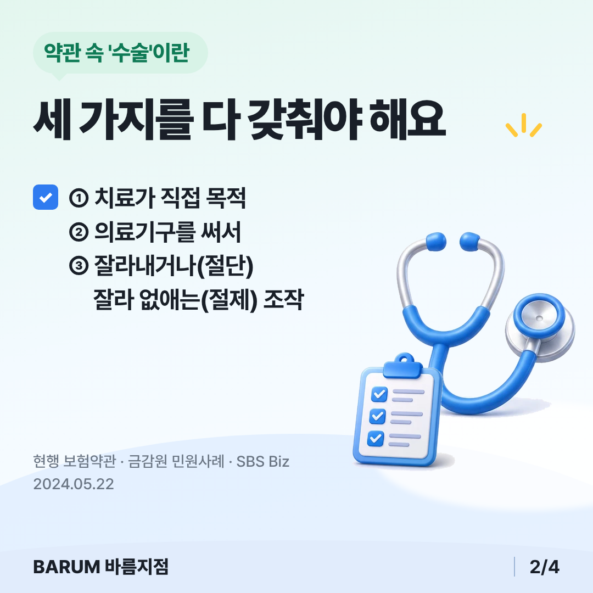
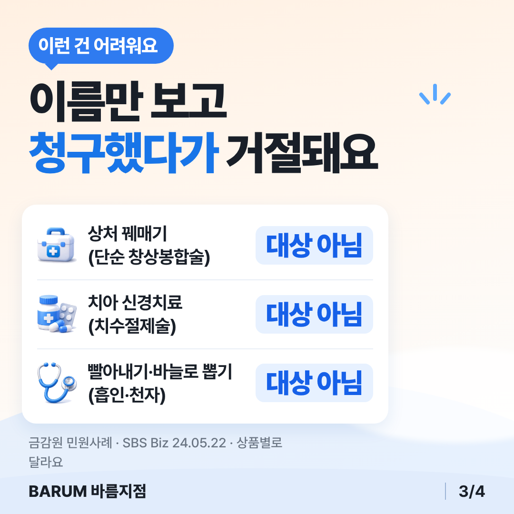

# 오늘 공부 — 수술 보험금은 이름보다 약관 뜻

## 카드뉴스 (정사각형 1080×1080 · 고객 공유용)

카드 묶음 받기: https://raw.githubusercontent.com/bokkile83-ui/barum-news/main/study/cards/2026-11-22-susul_카드.zip

## 한 줄로
- 치료 이름에 '술'이 있어도, 약관 속 '수술' 뜻에 맞아야 나와요.
## 꼭 알 것 3가지
- ① 약관 수술 = 치료 목적 + 의료기구 + 절단·절제(잘라냄) 조작.
- ② 단순 창상봉합술(상처 꿰매기)·치수절제술(신경치료)은 거절 사례.
- ③ 흡인(빨아냄)·천자(바늘로 뽑음)도 수술 보험금 대상 아님.
## 고객에게 이렇게
> "치료 이름보다 어떤 치료였는지가 중요해서, 약관 뜻부터 같이 볼게요."
## 출처
- [SBS Biz 2024.05.22 — 금감원 주요 민원사례 「명칭보다 약관 정의가 중요」](https://biz.sbs.co.kr/article/20000172721)
