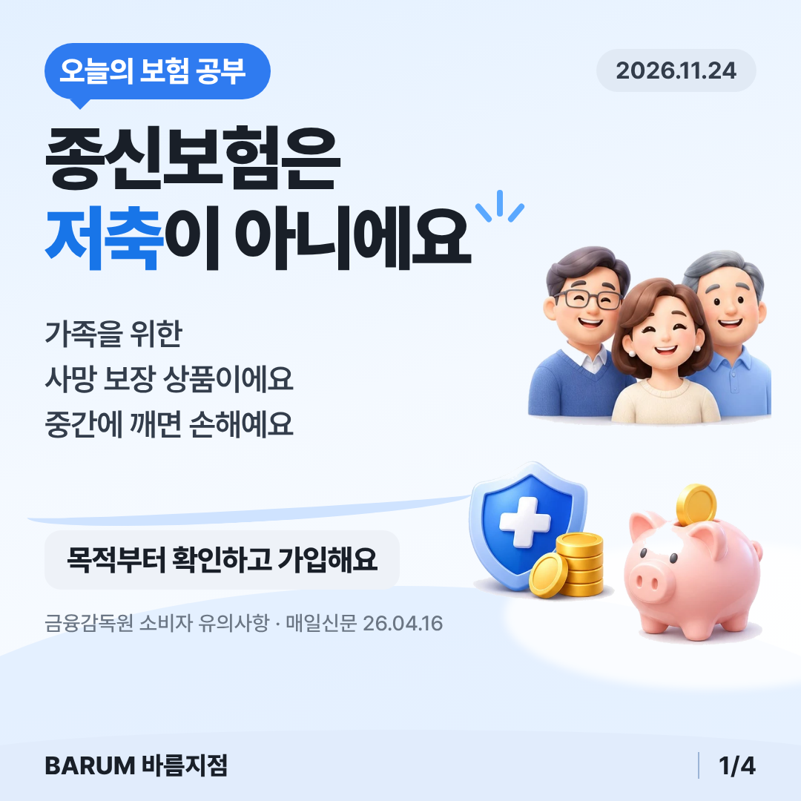
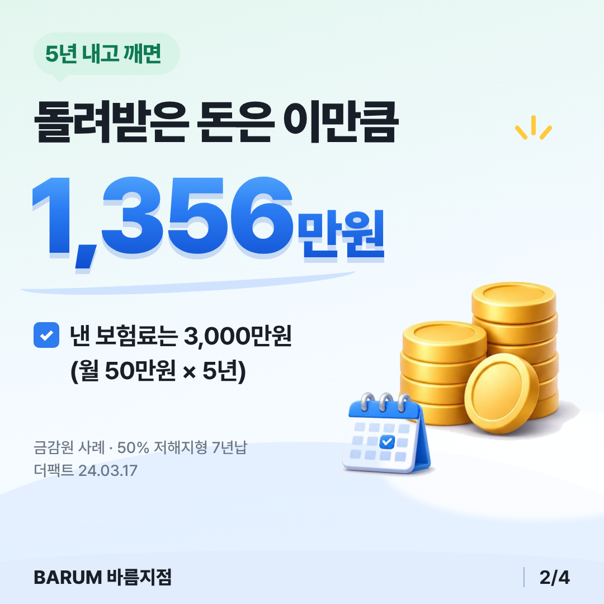
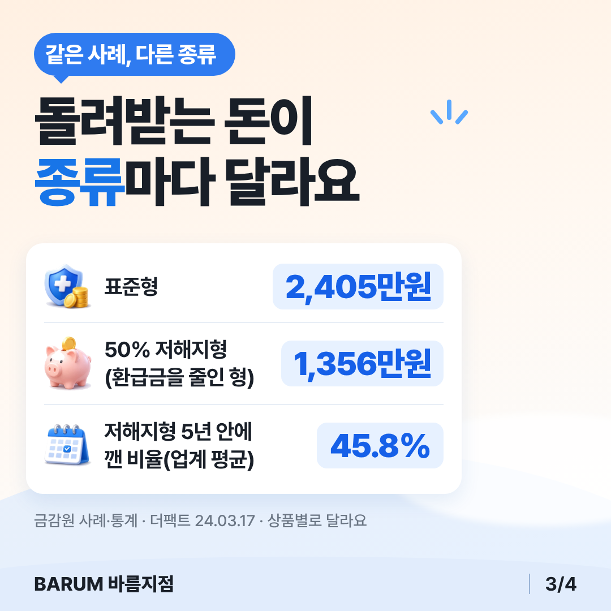

# 오늘 공부 — 종신보험은 저축이 아니에요

## 카드뉴스 (정사각형 1080×1080 · 고객 공유용)

카드 묶음 받기: https://raw.githubusercontent.com/bokkile83-ui/barum-news/main/study/cards/2026-11-24-jongsin_카드.zip

## 한 줄로
- 종신보험은 가족을 위한 사망 보장이고, 저축·노후용이 아니에요.
## 꼭 알 것 3가지
- ① 중간에 깨면 돌려받는 돈(해지환급금)이 낸 돈보다 적거나 없어요.
- ② 금감원 사례: 50% 저해지형, 월 50만원 5년 내고 깨니 1,356만원(표준형 2,405만원).
- ③ 금감원 권고: 소득·부양가족부터 보고, 안내 자료·녹취·문자를 보관.
## 고객에게 이렇게
> "이 보험은 모으는 돈이 아니라 가족을 지키는 보장이라, 쓰임새부터 같이 볼게요."
## 출처
- [매일신문 2026.04.16 — 금감원, 종신보험 불완전판매 '주의'](https://www.imaeil.com/page/view/2026041614404488145)
- [더팩트 2024.03.17 — 금감원 절판마케팅 소비자경보(저해지 종신 사례)](https://news.tf.co.kr/read/ogmeta/2083526.htm)
