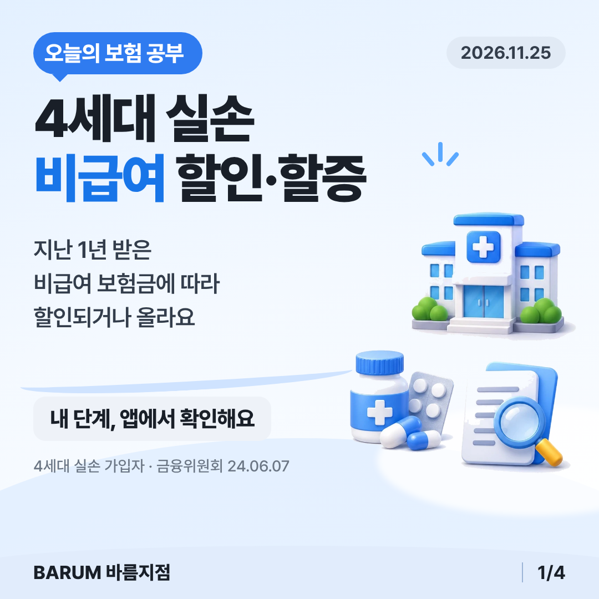
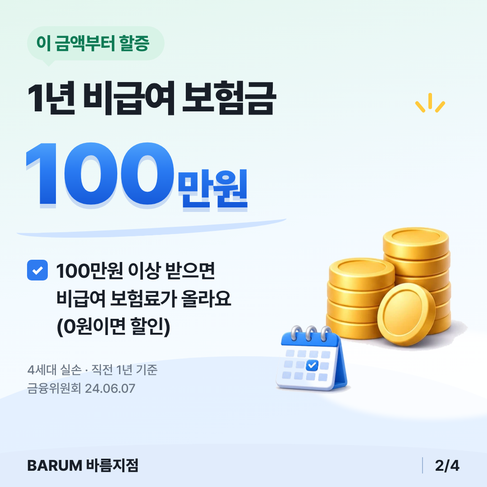
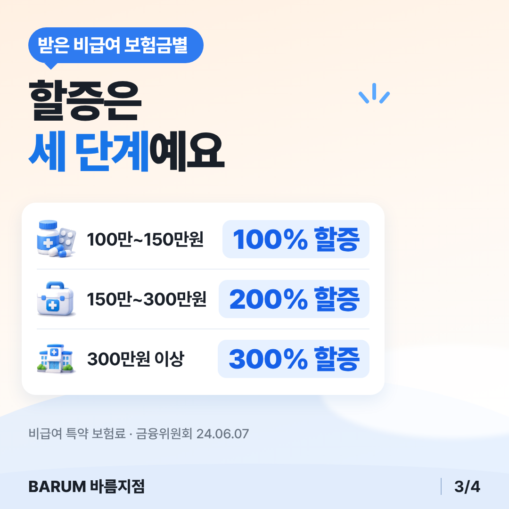
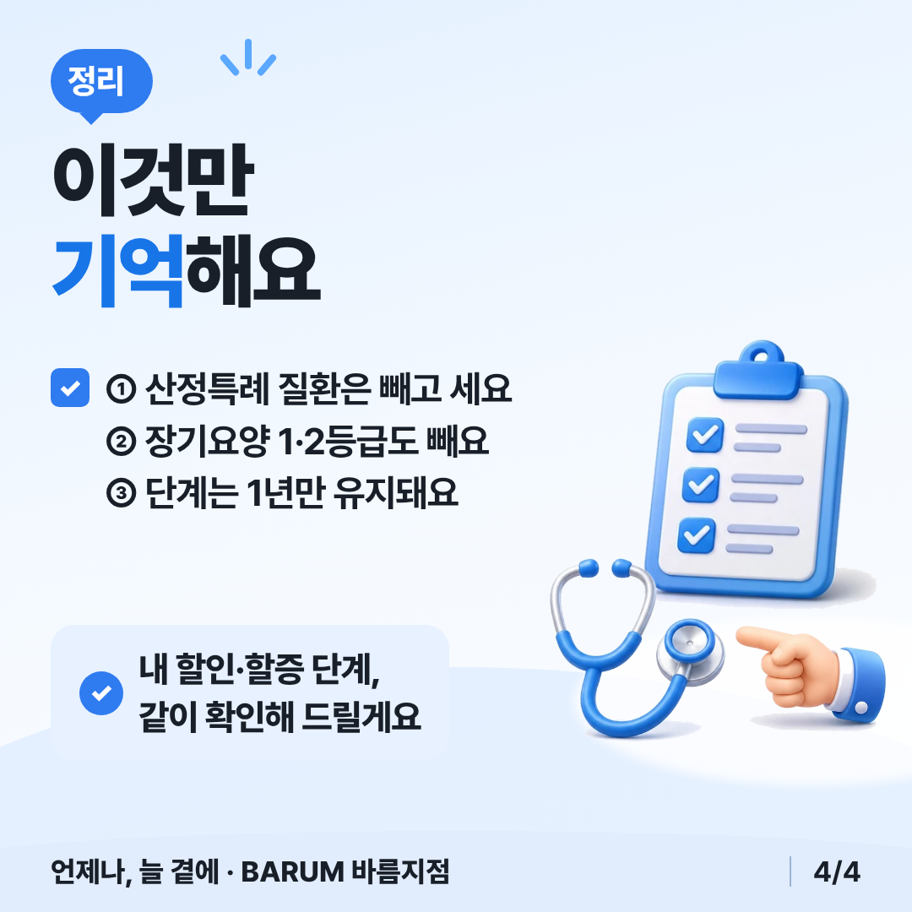

# 오늘 공부 — 4세대 실손 비급여 할인·할증

## 카드뉴스 (정사각형 1080×1080 · 고객 공유용)

카드 묶음 받기: https://raw.githubusercontent.com/bokkile83-ui/barum-news/main/study/cards/2026-11-25-silson4_카드.zip

## 한 줄로
- 4세대 실손은 작년 비급여 보험금만큼 비급여 보험료가 바뀌어요.
## 꼭 알 것 3가지
- ① 0원이면 할인, 100만원 미만이면 그대로예요.
- ② 100만↑ 100%, 150만↑ 200%, 300만↑ 300% 할증.
- ③ 산정특례 질환·장기요양 1·2등급은 빼고, 단계는 1년만.
## 고객에게 이렇게
> "보험사 앱에서 지금 단계와 남은 금액을 같이 볼게요."
## 출처
- [정책브리핑(금융위원회) 2024.06.07 — 4세대 실손 할인·할증 적용](https://www.korea.kr/news/policyNewsView.do?newsId=148930029)
- [매일신문 2026.09.16 — 4세대 실손 비급여 할증표](https://www.imaeil.com/page/view/2026091609281500927)
