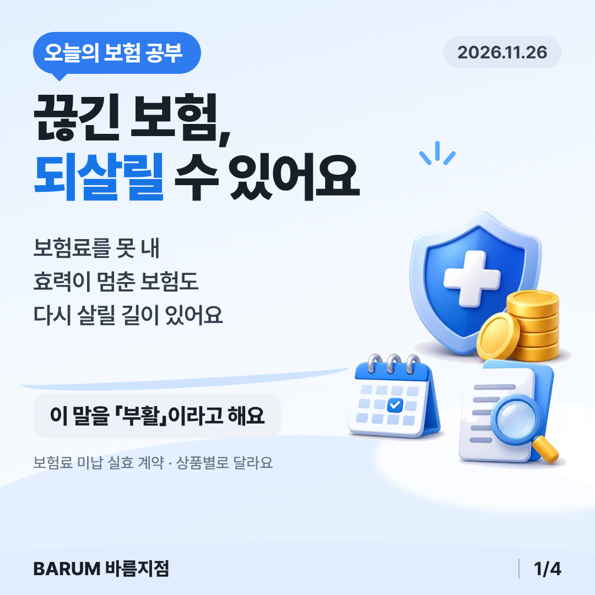
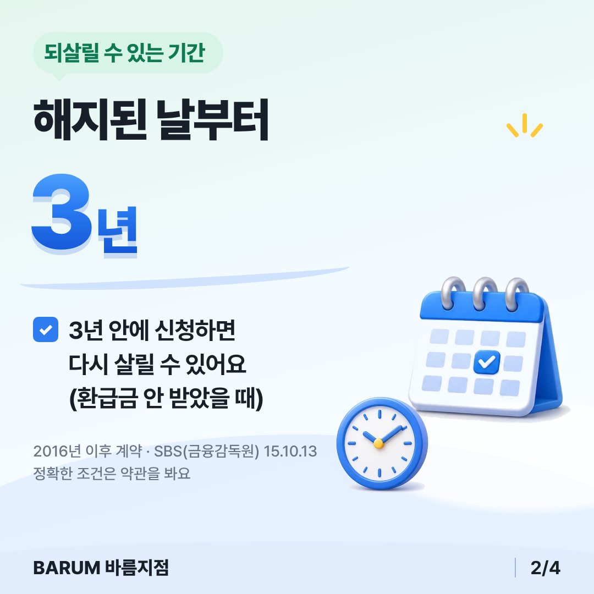
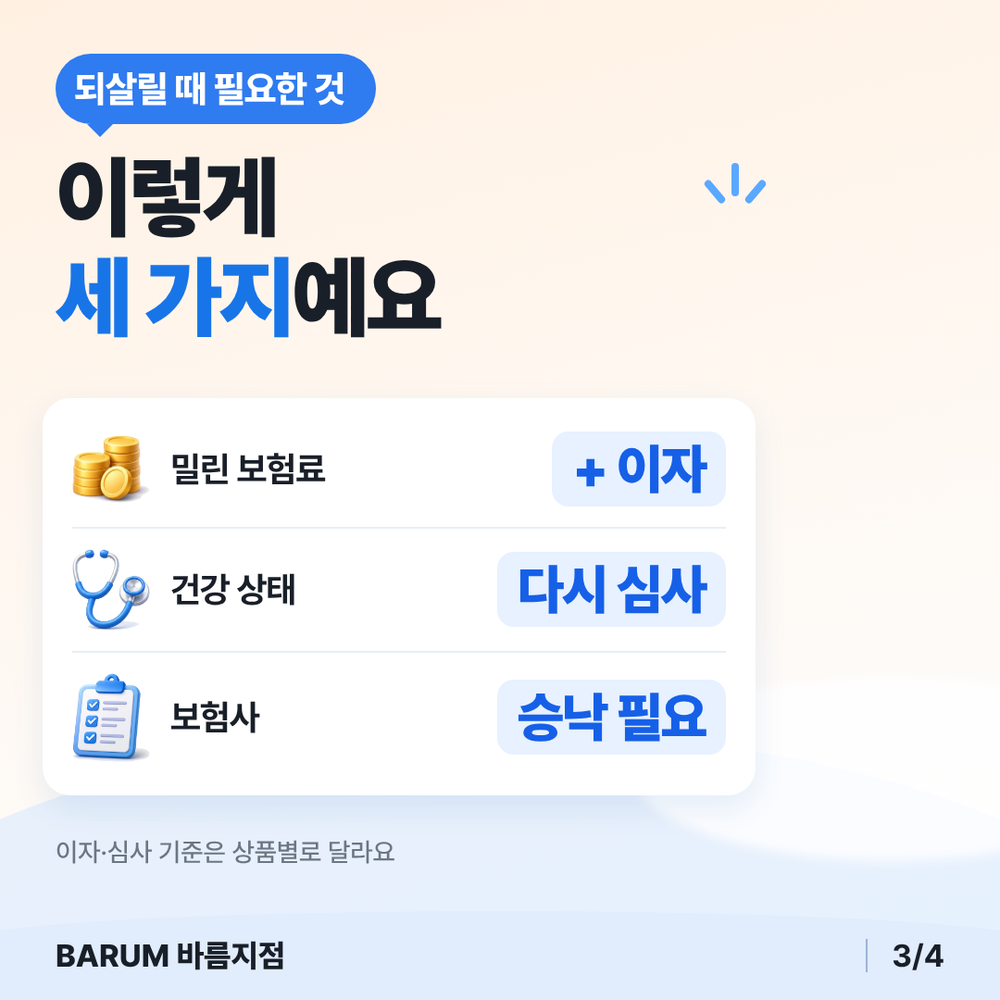
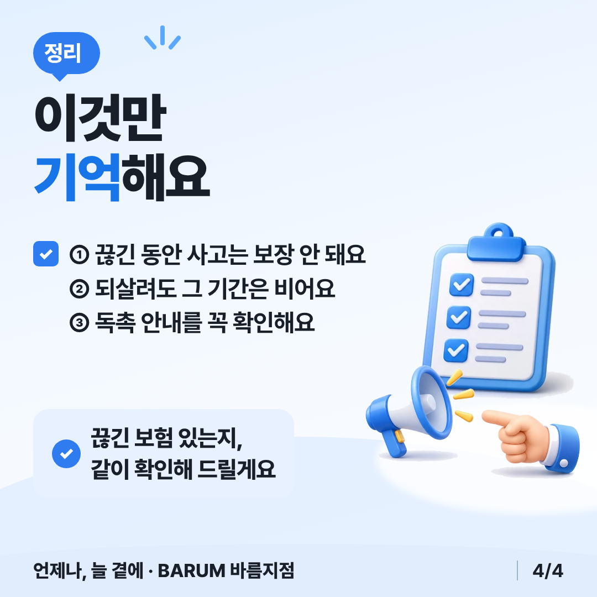

# 오늘 공부 — 끊긴 보험 되살리기(부활)

## 카드뉴스 (정사각형 1080×1080 · 고객 공유용)

카드 묶음 받기: https://raw.githubusercontent.com/bokkile83-ui/barum-news/main/study/cards/2026-11-26-buhwal_카드.zip

## 한 줄로
- 보험료를 못 내 끊긴(실효) 보험도 3년 안엔 되살릴 수 있어요.
## 꼭 알 것 3가지
- ① 보험사는 14일 이상 독촉(납입최고) 후 해지해요.
- ② 해지 후 3년 안에 부활(효력회복, 다시 살림) 신청.
- ③ 밀린 보험료+이자, 건강 심사, 보험사 승낙이 필요해요.
## 고객에게 이렇게
> "끊긴 동안 생긴 일은 보장이 안 돼서, 지금 상태부터 같이 볼게요."
## 출처
- [SBS 2015.10.13 — 금감원, 부활 신청 기한 2→3년](https://news.sbs.co.kr/news/endPage.do?news_id=N1003214416)
- [EBN — 2016년 1월 신계약분부터 3년 적용](https://www.ebn.co.kr/news/articleView.html?idxno=796416)
