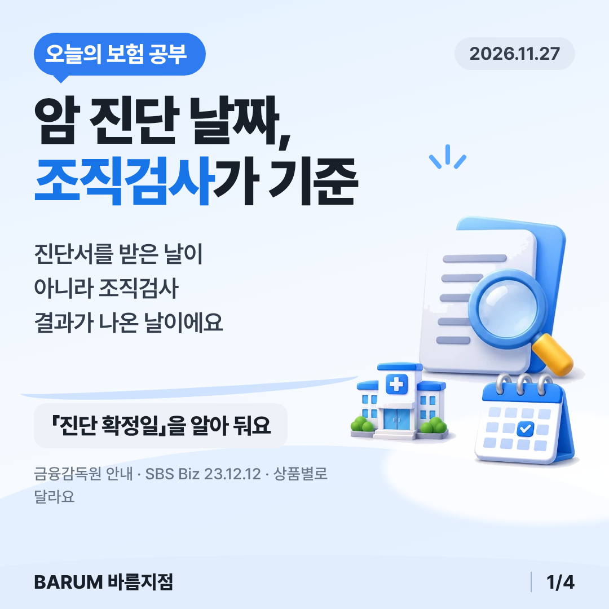
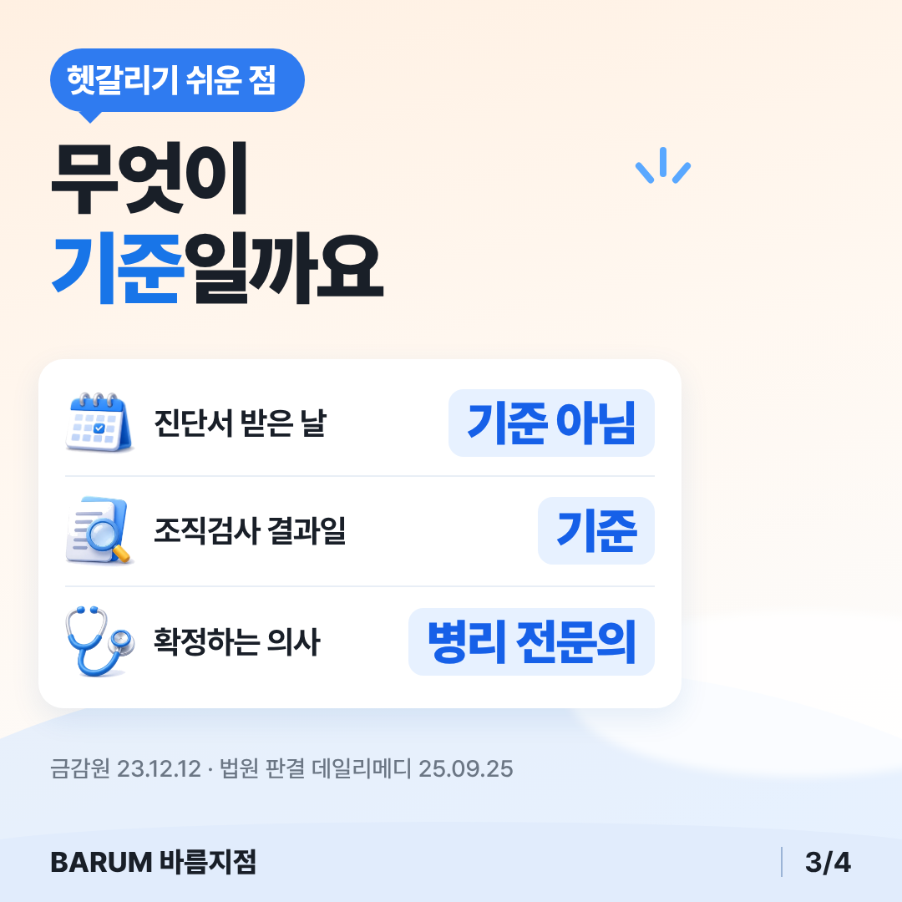
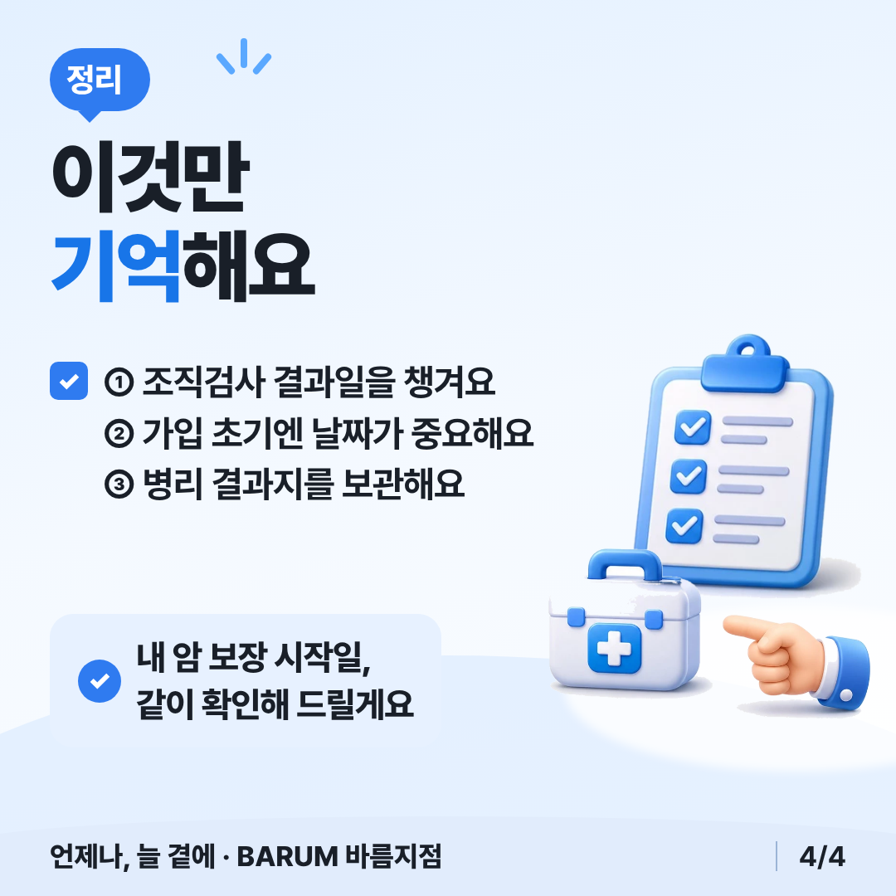

# 오늘 공부 — 암 진단 날짜는 조직검사 결과일
## 카드뉴스 (정사각형 1080×1080 · 고객 공유용)

카드 묶음 받기: https://raw.githubusercontent.com/bokkile83-ui/barum-news/main/study/cards/2026-11-27-amjindan_카드.zip

## 한 줄로
- 암 진단 확정일은 진단서 날짜가 아닌 조직검사 결과일이에요.
## 꼭 알 것 3가지
- ① 조직검사 결과보고일이 보장개시일 뒤여야 받아요.
- ② 보장개시일(보장 시작일)은 보통 가입 후 90일(상품별 다름).
- ③ 확정은 병리 전문의(조직을 현미경으로 보는 의사) 소견 기준.
## 고객에게 이렇게
> "진단서 날짜보다 조직검사 결과 날짜가 중요해서, 결과지를 같이 볼게요."
## 출처
- [SBS Biz 2023.12.12 — 금감원, 암 진단 기준일 안내](https://biz.sbs.co.kr/amp/article/20000148143)
- [데일리메디 2025.09.25 — 병리의사 조직검사 결과가 기준](https://dailymedi.com/news/news_view.php?wr_id=928760)
