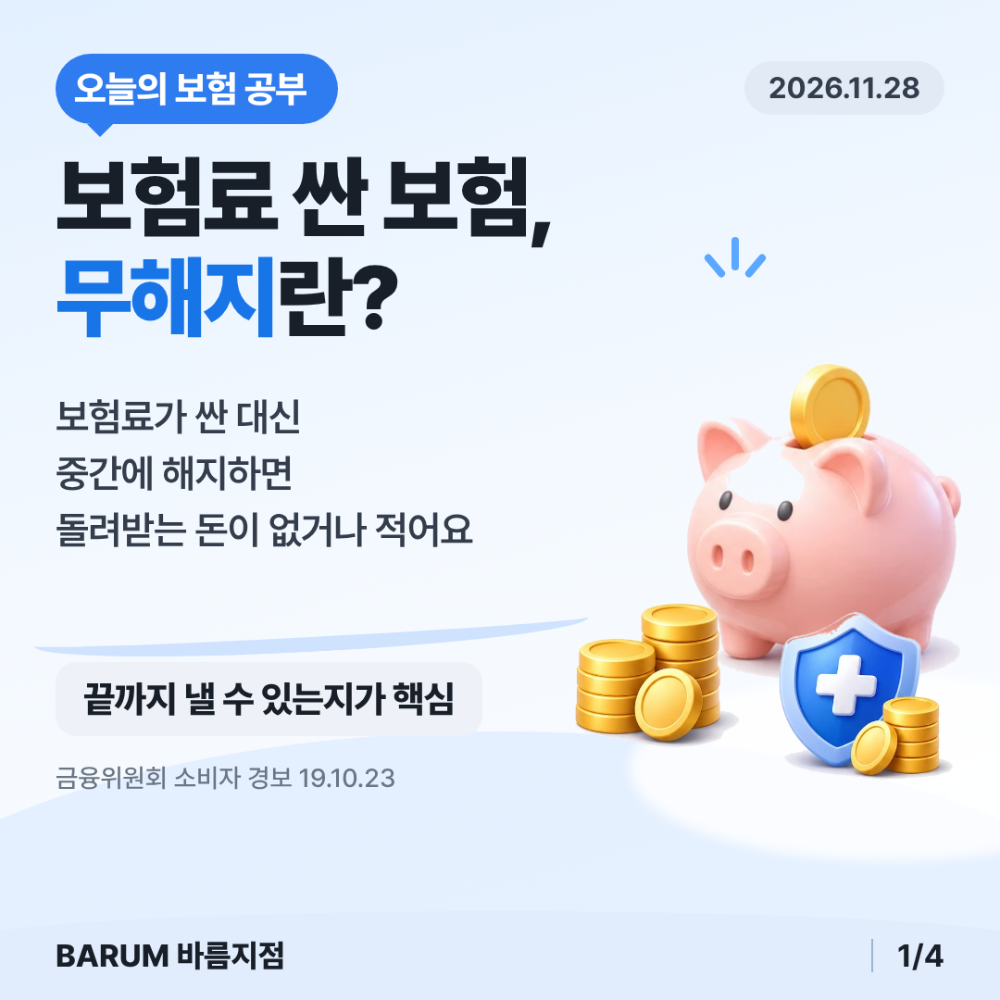
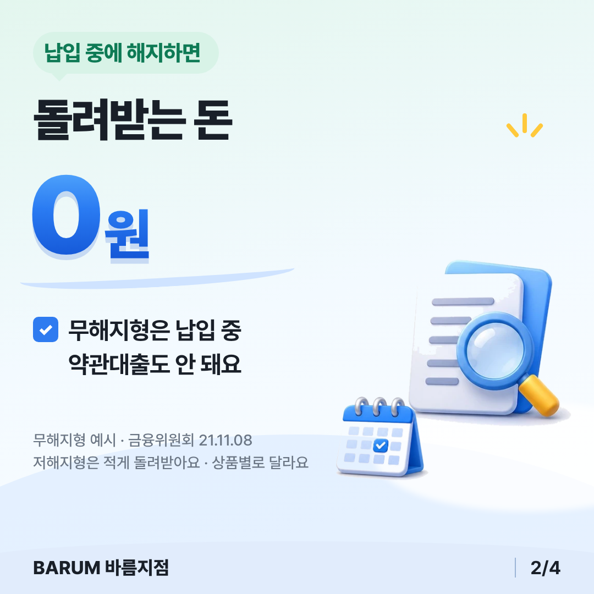
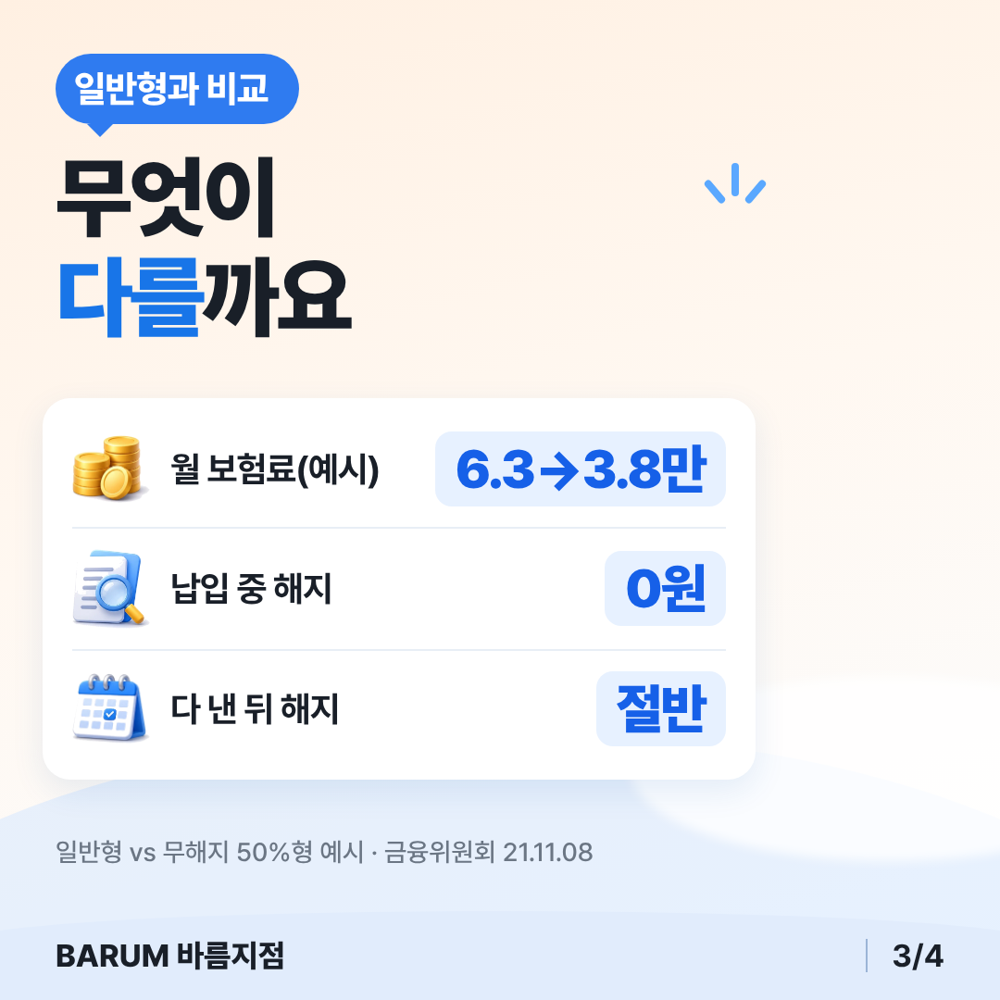
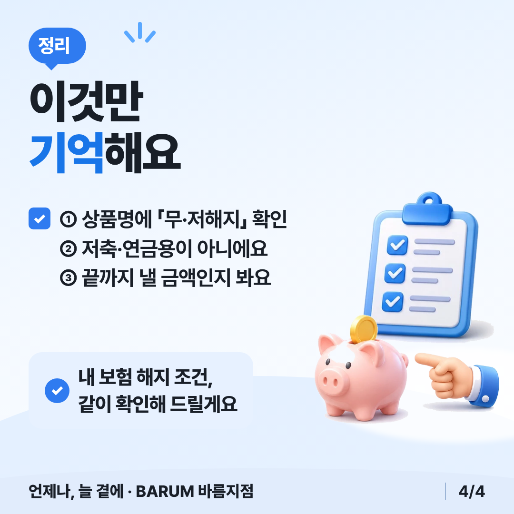

# 오늘 공부 — 무해지 보험, 싼 대신 중간 해지는 손해
## 카드뉴스 (정사각형 1080×1080 · 고객 공유용)

카드 묶음 받기: https://raw.githubusercontent.com/bokkile83-ui/barum-news/main/study/cards/2026-11-28-muhaeji_카드.zip

## 한 줄로
- 무·저해지(해지환급금 없거나 적은) 보험은 싸지만 중간에 깨면 손해예요.
## 꼭 알 것 3가지
- ① 납입 중 해지하면 환급금(돌려받는 돈)이 없거나 적어요.
- ② 무해지형은 납입 중 약관대출(보험금 담보 대출)이 안 돼요.
- ③ 보장용 상품이에요. 저축·연금 목적엔 맞지 않아요.
## 고객에게 이렇게
> "보험료가 싼 대신 중간에 해지하면 돌려받는 돈이 거의 없어요, 끝까지 낼 수 있는 금액인지 같이 볼게요."
## 출처
- [금융위원회 2019.10.23 — 무·저해지 보험 소비자 경보](https://www.fsc.go.kr/no010101/73932)
- [금융위원회 2021.11.08 — 무·저해지보험 상품설계 개선](https://www.fsc.go.kr/no010101/76830?curPage=1)
