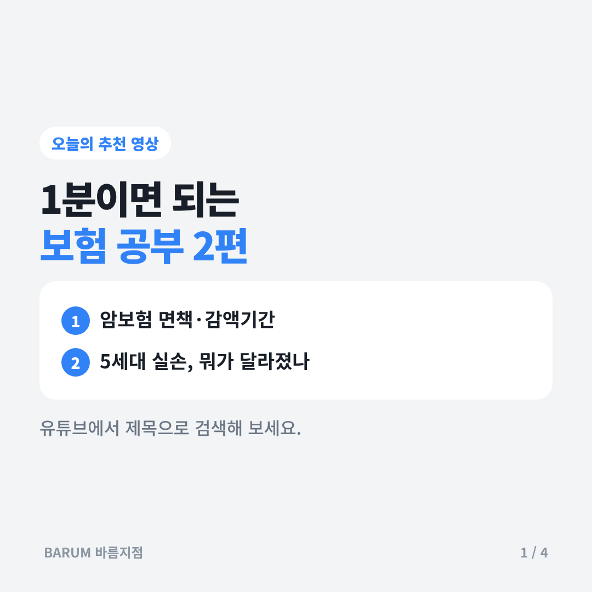
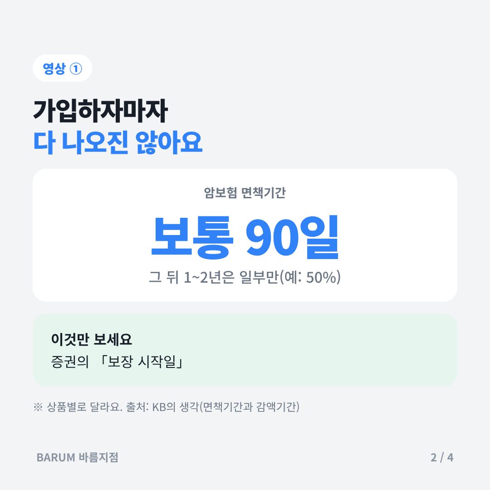
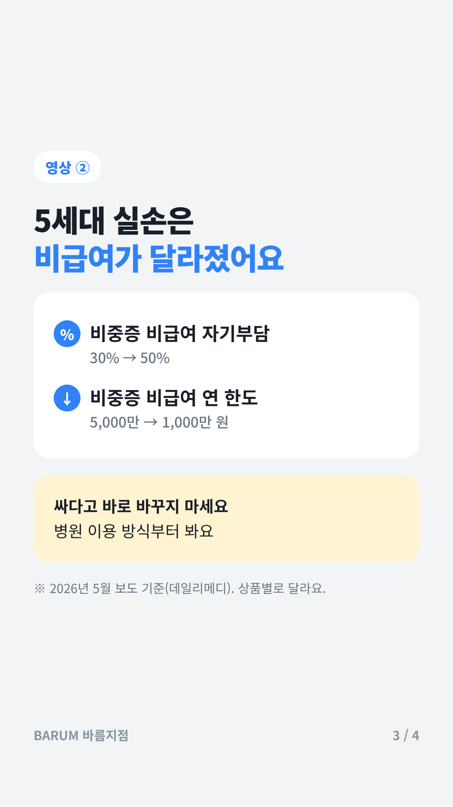
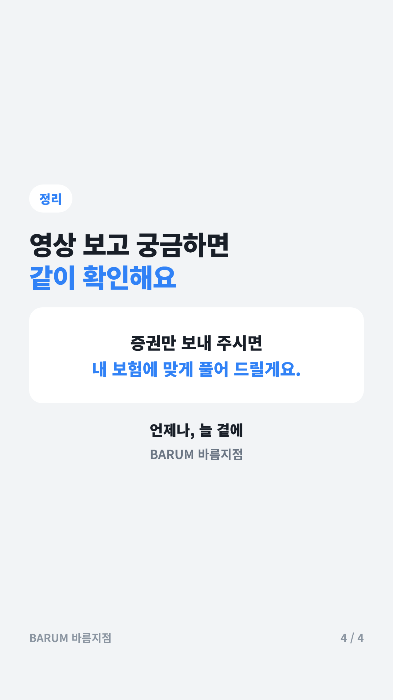

# 2026-11-13 오늘의 추천 영상

## 카드뉴스 (정사각형 1080×1080 · 고객 공유용)

카드 묶음 받기: https://raw.githubusercontent.com/bokkile83-ui/barum-news/main/yt/cards/2026-11-13_카드.zip?v=sq2

## 암보험 면책기간·감액기간

- [보험 가입 후 면책기간에 대해 초특급이 알려줄게!](https://www.youtube.com/watch?v=9Kbj1Co34ZA)
- 한 줄: 가입 직후 보장이 안 되는 기간(면책)과 일부만 주는 기간(감액)을 다룬 영상이다.
- 공식 자료로 확인: [KB의 생각 — 면책기간과 감액기간](https://kbthink.com/insurance-guide/waiting-and-reduction-periods.html)

## 5세대 실손 달라지는 점

- [5세대 실손보험 총정리｜달라지는 것 7가지](https://www.youtube.com/watch?v=CFQp20ebnnA)
- 한 줄: 5세대 실손에서 바뀌는 자기부담·한도를 정리한 영상이다(채널명 [확인]).
- 공식 자료로 확인: [데일리메디 — 5세대 실손보험 출시](https://www.dailymedi.com/news/news_view.php?wr_id=936208)

> 영상은 검색 결과의 제목으로 고른 것이다. 내용은 회사·상품마다 다를 수 있으니 공식 자료와 같이 본다.
