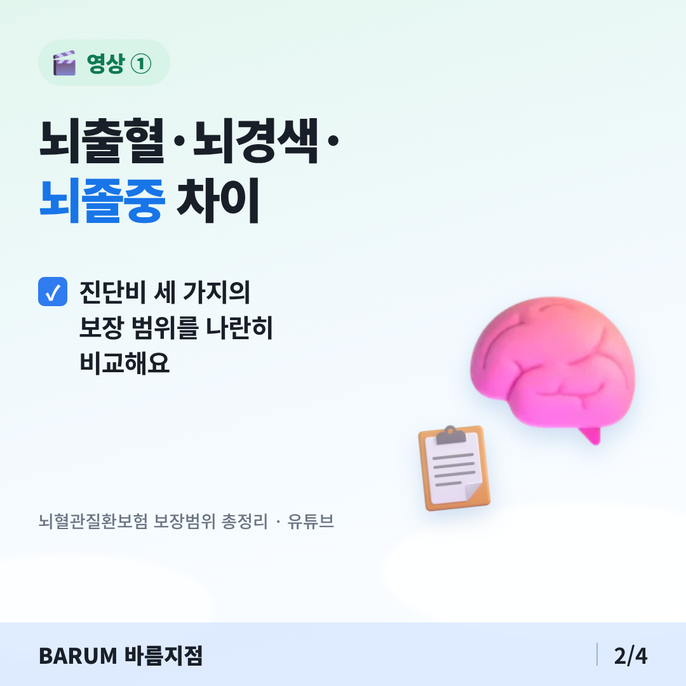
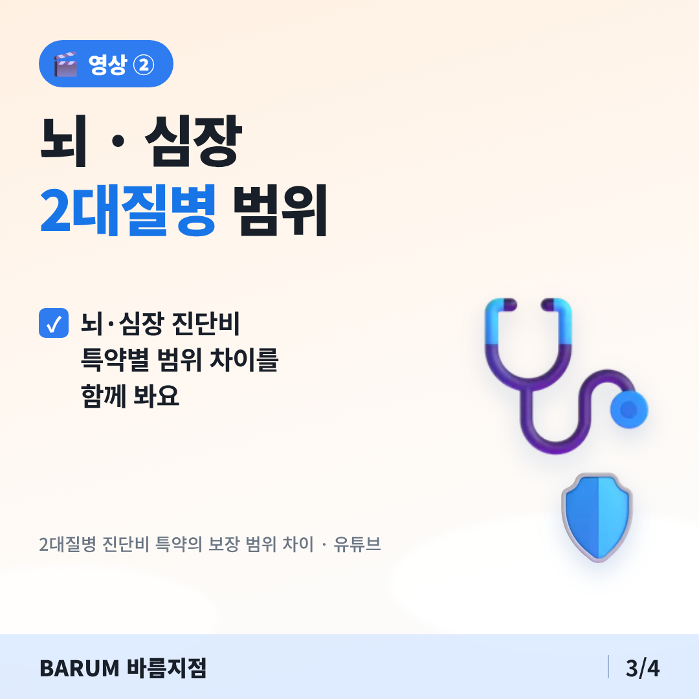
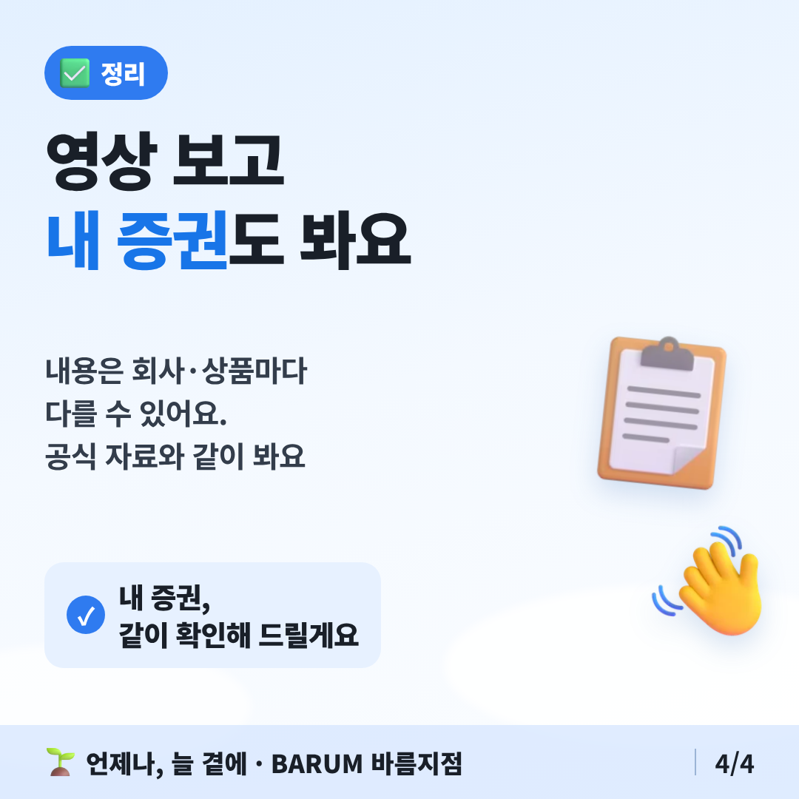

# 2026-11-14 오늘의 추천 영상

## 카드뉴스 (정사각형 1080×1080 · 고객 공유용)

카드 묶음 받기: https://raw.githubusercontent.com/bokkile83-ui/barum-news/main/yt/cards/2026-11-14-noehyeolgwan-v3_카드.zip

## 뇌출혈·뇌경색·뇌졸중 차이

- [뇌혈관질환보험 보장범위 총정리｜뇌출혈·뇌경색·뇌졸중 차이!](https://www.youtube.com/watch?v=WALX_uLcEdk)
- 한 줄: 뇌 진단비 세 가지의 보장 범위를 비교하는 영상.
- 공식 자료로 확인: [KB의 생각 — 특약별 진단비 보장 범위](https://kbthink.com/insurance/trend/cerebrovascular-disease.html)

## 2대질병(뇌·심장) 진단비 범위

- [2대질병 진단비 특약의 보장 범위 차이 (뇌혈관질환, 뇌졸중, 뇌경색, 뇌출혈, 허혈성심장질환, 급성심근경색증)](https://www.youtube.com/watch?v=uBw5HvN9bEI)
- 한 줄: 뇌·심장 진단비 특약별 범위 차이를 함께 보는 영상.
- 공식 자료로 확인: [KB의 생각 — 특약별 진단비 보장 범위](https://kbthink.com/insurance/trend/cerebrovascular-disease.html)

> 영상은 검색 결과의 제목으로 고른 것이다. 내용은 회사·상품마다 다를 수 있으니 공식 자료와 같이 본다.
