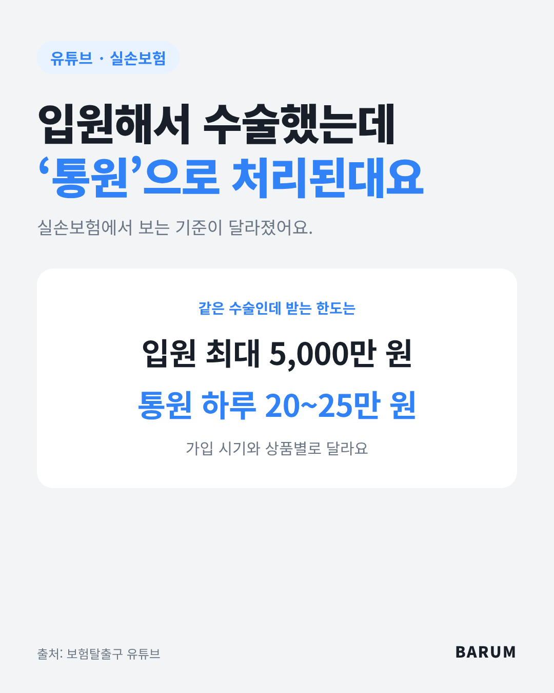
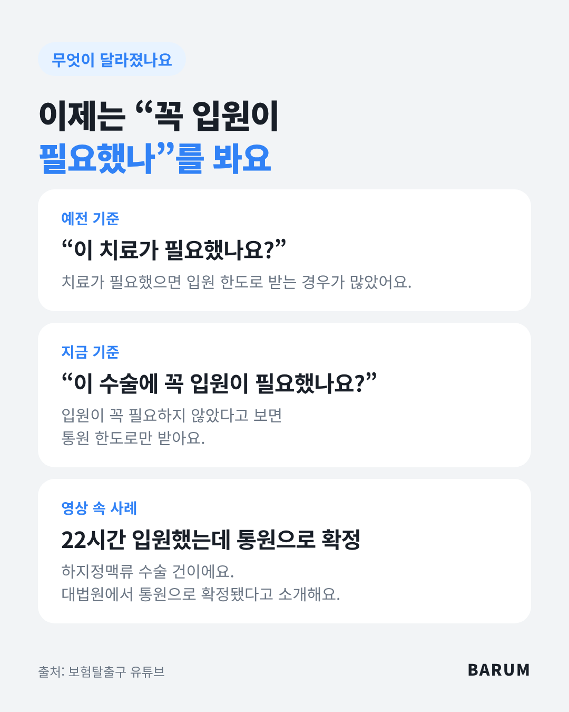
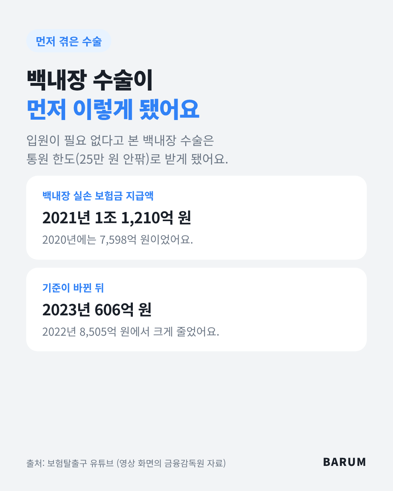
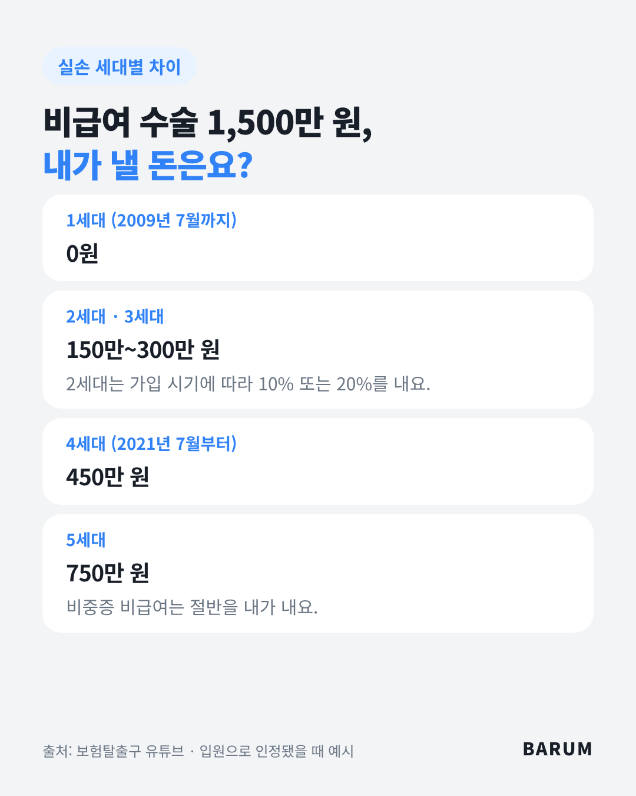
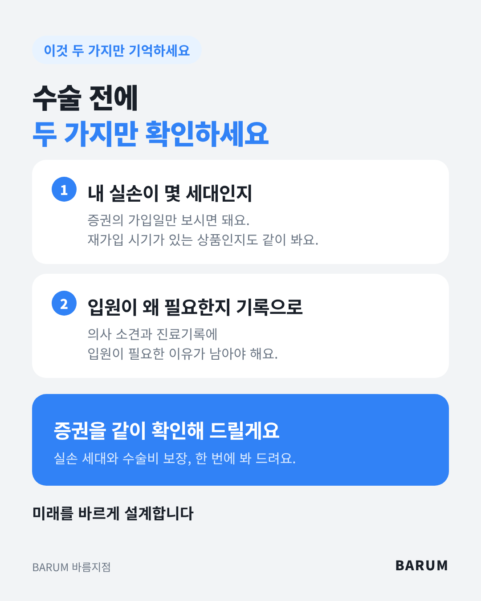

# 2026-11-16 오늘의 추천 영상

## 카드뉴스 (세로 1080×1350 · 고객 공유용)

카드 묶음 받기: https://raw.githubusercontent.com/bokkile83-ui/barum-news/main/yt/cards/2026-11-16_카드.zip

## 실손보험 — 입원해서 수술했는데 통원 처리

- ['실손보험 입원해서 수술했는데 통원으로?' 보험금 판단 기준이 바뀌었습니다..](https://www.youtube.com/watch?v=NnSdbAPu1IA)
- 한 줄: 실손보험이 「치료가 필요했나」가 아니라 「꼭 입원이 필요했나」로 입원·통원을 가른다는 내용의 영상.
- 채널: 보험탈출구 · 올린 날짜 2026-11-16

## 핵심 정리
- 실손보험에서 보는 기준이 달라졌어요. 예전에는 「이 치료가 필요했나」를 봤고, 지금은 「이 수술에 꼭 입원이 필요했나」를 봐요. (00:00)
- 입원으로 인정되면 통상 최대 5,000만 원 한도, 통원이면 하루 20만~25만 원 한도예요. 가입 시기와 상품별로 달라요. (00:00~01:20)
- 영상 속 사례: 하지정맥류 수술로 22시간 병원에 있었는데 통원으로 처리됐고, 대법원에서 확정됐다고 소개해요. (00:46)
- 백내장 수술이 먼저 이렇게 됐어요. 백내장 실손 보험금 지급액이 2021년 1조 1,210억 원에서 2023년 606억 원으로 줄었어요(영상 화면의 금융감독원 자료). (01:04)
- 입원 한도로 받으려면 네 가지가 맞아야 해요: 입원 필요성, 의학적 타당성, 치료 목적, 약관 기준. (01:21)
- 비급여 수술 1,500만 원을 입원으로 인정받았을 때 내가 내는 돈 예시: 1세대 0원, 2세대 150만 또는 300만 원, 3세대 300만 원, 4세대 450만 원, 5세대 750만 원. (03:21)
- 재가입 주기: 2013년 4월~2021년 6월 가입자는 15년, 2021년 7월 이후 가입자는 5년이라고 설명해요. 그때 판매 중인 실손으로 바뀌어요. (04:27)
- 영상 뒷부분(06:36 이후)은 수술비 보험과 비급여 암 치료비 상품 안내예요. 광고 심의필 표시가 있는 부분이라 여기에는 옮기지 않았어요.

## 설계사에게
- 결론: 「입원했으니 입원 한도로 나온다」고 말하면 안 된다. 입원 필요성이 기록으로 남아야 한다.
- 수술을 앞둔 고객에게는 의사 소견서·진료기록에 입원이 필요한 이유(수술 후 관찰, 합병증 위험 등)가 적히는지 확인하게 한다.
- 실손 세대를 증권 가입일로 먼저 확인한다. 세대에 따라 비급여 자기부담이 0원에서 절반까지 벌어진다.
- 2013년 4월 이후 가입 고객은 재가입 시기를 같이 알려 준다. 재가입 때 보장이 바뀐다.
- [확인] 영상의 판결 번호·선고일(대법원 2026.6.11. 2026다202566 등)과 5세대 실손 출시 시기·한도(비급여 통원 연 500만 원, 연간 1,000만 원)는 영상 화면 기준이다. 고객에게 말하기 전에 판결문과 금융당국 자료로 확인한다.
- 수술비 특약으로 연결할 때는 특정 상품 보험료를 영상 숫자 그대로 말하지 않는다. 상품·나이·직업급수별로 다르다.

## 오늘 고객에게 한마디
> 「입원해서 수술하셔도 실손에서는 통원으로 볼 수 있어요. 수술 전에 실손 가입일과 입원이 필요한 이유, 이 두 가지만 같이 확인해요.」

— BARUM 바름지점

> 내용은 회사·상품마다 다를 수 있으니 공식 자료와 같이 본다.
