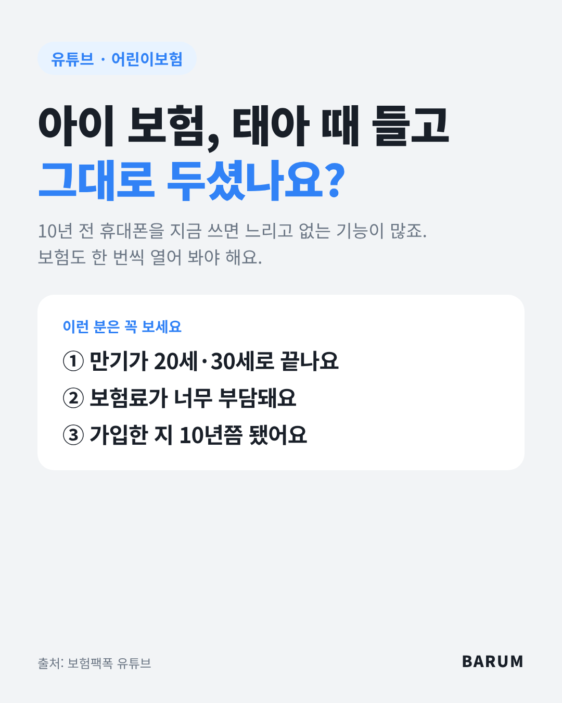
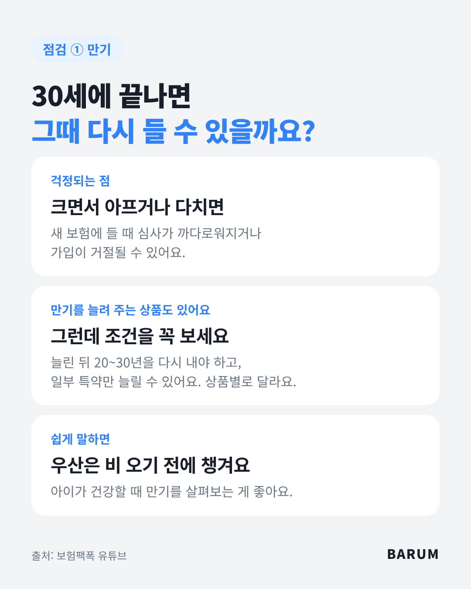
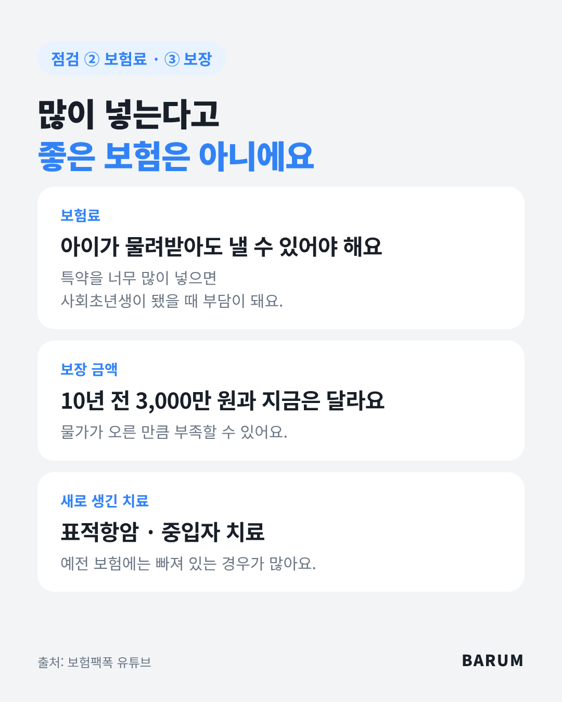
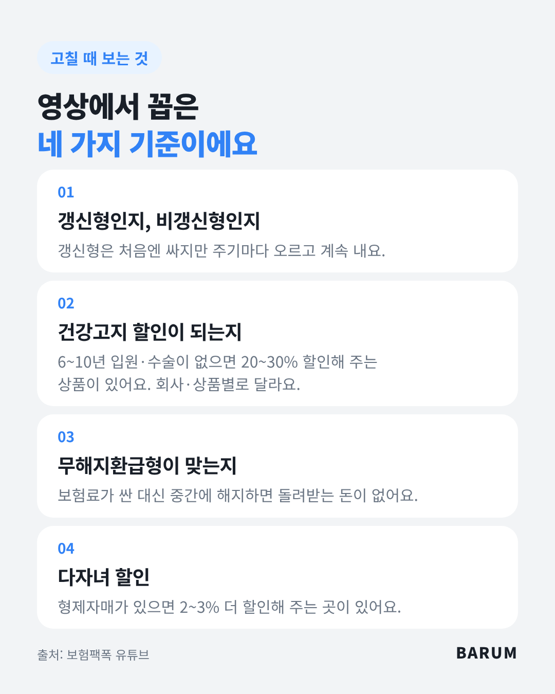
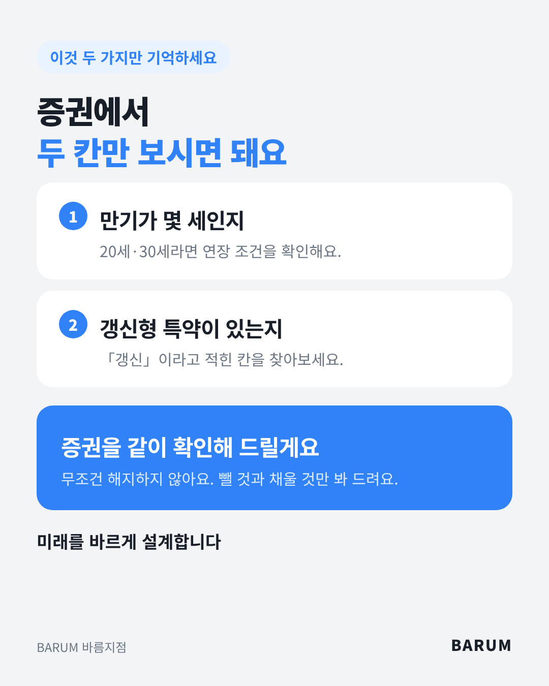

# 2026-11-17 오늘의 추천 영상

## 카드뉴스 (세로 1080×1350 · 고객 공유용)

카드 묶음 받기: https://raw.githubusercontent.com/bokkile83-ui/barum-news/main/yt/cards/2026-11-17_카드.zip

## 어린이보험 — 30세 만기와 100세 만기, 갈아탈까 유지할까

- [어린이보험 30세만기 100세만기 갈아타기 고민이세요?](https://www.youtube.com/watch?v=U_AhH_F_lhA)
- 한 줄: 예전에 든 어린이보험을 만기·보험료·보장 세 가지로 점검하고, 고칠 때 볼 기준을 알려 주는 영상.
- 채널: 보험팩폭 · 올린 날짜 2026-11-13

## 핵심 정리
- 태아 때 든 보험을 그대로 두는 게 가장 흔한 실수라고 해요. 5~10년 전과 지금은 치료 방법과 특약이 달라졌어요. 무조건 해지가 아니라 낡은 부분만 고치는 게 목적이에요. (00:00)
- 점검 ① 만기: 20세·30세에 끝나면 그 뒤 새로 들 때 병력 때문에 심사가 까다롭거나 거절될 수 있어요. 만기를 늘려 주는 상품도 있지만, 늘린 뒤 20~30년을 다시 내야 하고 일부 특약만 늘릴 수 있어요. 상품별로 달라요. (01:19)
- 점검 ② 보험료: 100세 만기라도 특약을 너무 많이 넣으면 아이가 사회초년생이 됐을 때 부담이 돼요. (02:43)
- 점검 ③ 보장: 10년 전 암 진단비 3,000만 원은 지금 물가에는 부족할 수 있어요. 표적항암제·중입자 치료 같은 새 치료 보장이 빠져 있는 경우가 많아요. (04:00)
- 고칠 때 보는 기준: 갱신형보다 비갱신형, 건강고지 할인(최근 6~10년 입원·수술 이력이 없으면 20~30% 할인), 끝까지 유지할 거라면 무해지환급형, 다자녀 할인 2~3%. 회사·상품별로 달라요. (04:55~08:44)
- 기본 특약 네 가지로 실손의료비, 암·뇌·심장 진단비, 수술비, 가족일상생활중배상책임을 꼽아요. (05:42)
- 영상 뒷부분(08:45 이후)은 5세 기준 보험료 비교와 상담 안내예요. 광고 심의필 표시가 있는 부분이라 보험료 숫자와 연락처는 옮기지 않았어요.

## 설계사에게
- 결론: 어린이보험 상담은 「갈아타라」가 아니라 「만기·갱신 여부·보장 금액 세 가지를 같이 본다」로 시작한다.
- 20세·30세 만기 고객: 만기 연장(계약 전환) 기능이 있는지 약관으로 먼저 확인한다. 연장 범위와 추가 납입 기간을 같이 알려 준다.
- 갈아타기를 권할 때는 기존 계약 해지 전에 새 계약 인수 여부부터 확인한다. 면책·감액 기간과 병력 고지 문제는 영상에서 다루지 않았으니 따로 설명해야 한다.
- 무해지환급형은 중도 해지 시 환급금이 없다는 점을 반드시 같이 말한다.
- [확인] 건강고지 할인율(20~30%), 다자녀 할인율(2~3%), 할인 가능한 회사 수는 영상 기준이다. 회사별 현재 기준으로 확인 후 말한다.

## 오늘 고객에게 한마디
> 「아이 보험 증권에서 만기가 몇 세인지, 갱신형 특약이 있는지 두 칸만 같이 봐요. 무조건 바꾸자는 게 아니라, 뺄 것과 채울 것만 확인해 드릴게요.」

— BARUM 바름지점

> 내용은 회사·상품마다 다를 수 있으니 공식 자료와 같이 본다.
