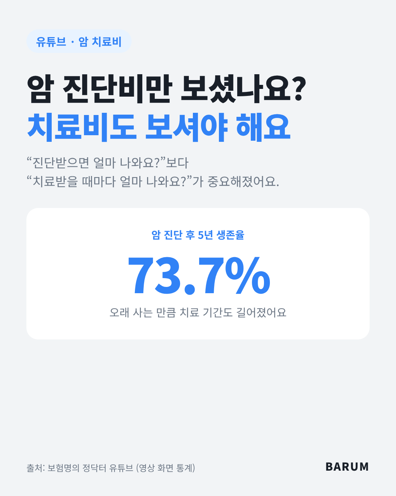
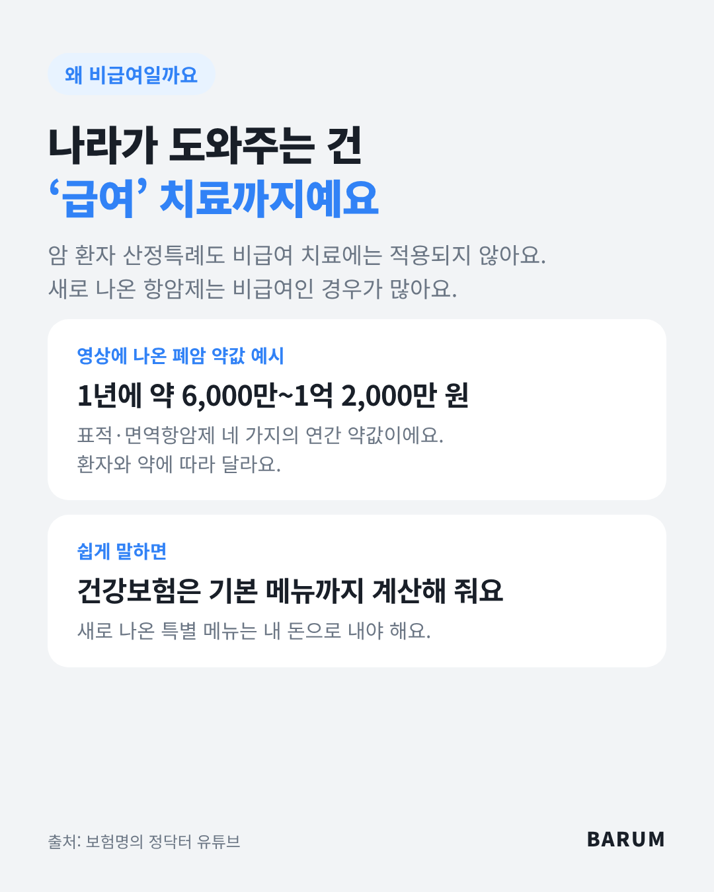
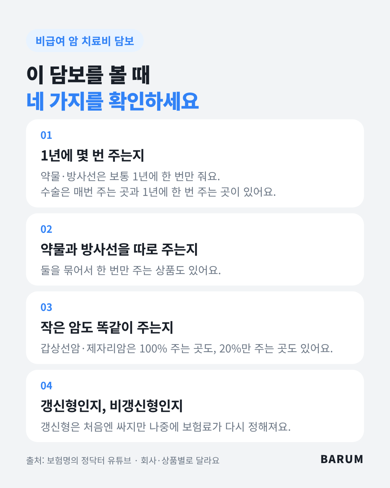
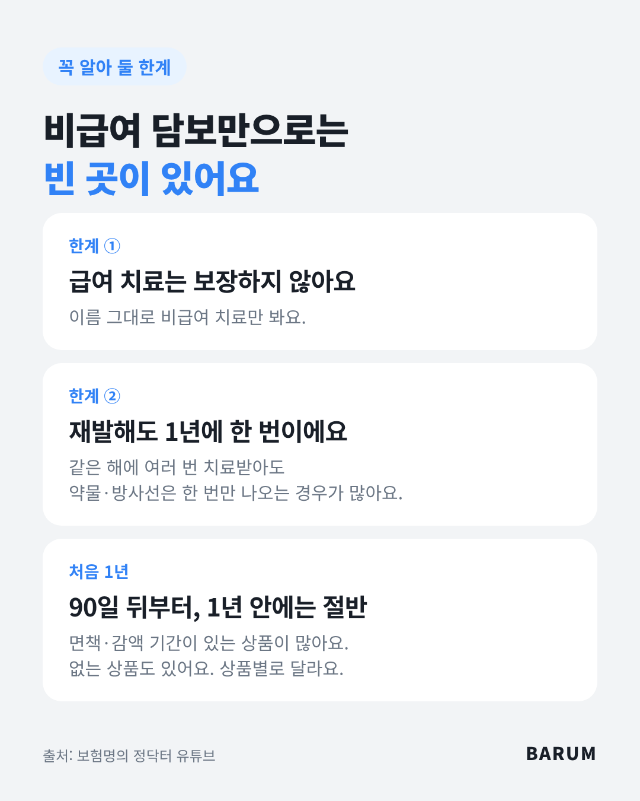
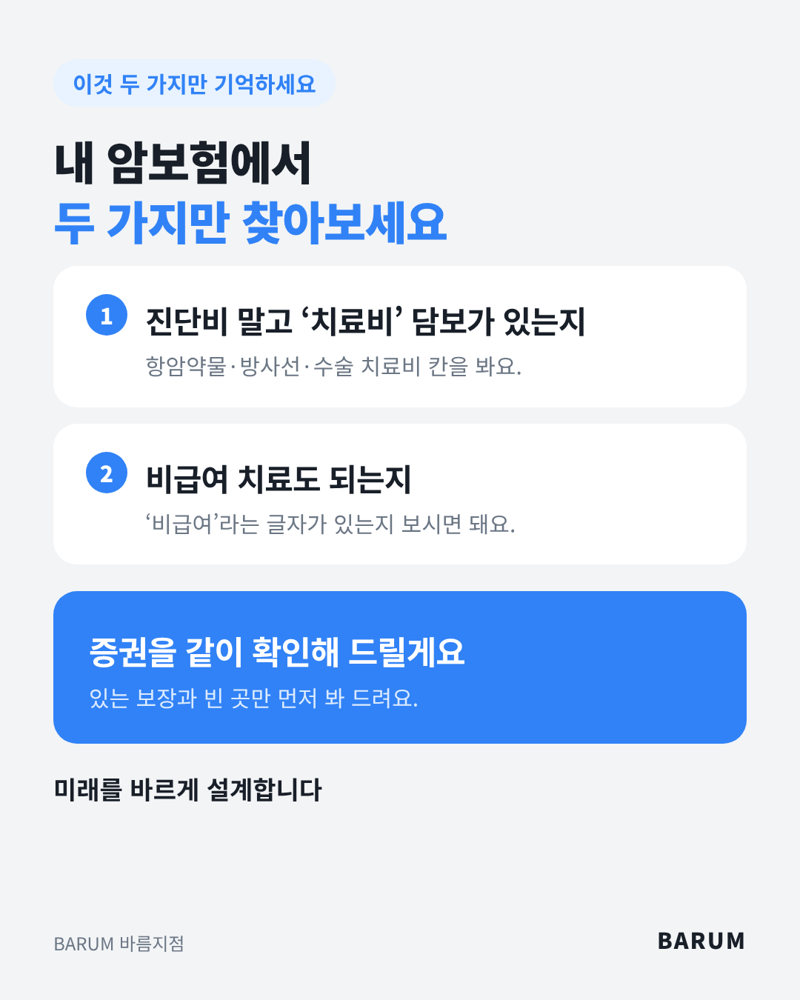

# 2026-11-18 오늘의 추천 영상

## 카드뉴스 (세로 1080×1350 · 고객 공유용)

카드 묶음 받기: https://raw.githubusercontent.com/bokkile83-ui/barum-news/main/yt/cards/2026-11-18_카드.zip

## 비급여 암 치료비 — 진단비만으로는 부족한 이유

- [비급여 암치료비 이 영상 하나로 끝!](https://www.youtube.com/watch?v=pHwL9JUrlCM)
- 한 줄: 10개 보험사의 비급여 암 주요치료비 담보를 회사별로 비교하는 설계사 대상 영상(1부).
- 채널: 보험명의 정닥터 · 올린 날짜 2026-11-17
- 이 글은 영상 1시간 21분 중 **앞 40분(10개사 중 5개사)**만 보고 썼다. 뒷부분 5개사와 정리 부분은 들어 있지 않다.

## 핵심 정리
- 상담 질문이 바뀌었어요. 「진단받으면 얼마 나와요?」가 아니라 「치료받을 때마다 얼마 나와요?」를 봐야 해요. (24:02)
- 영상 화면 통계: 2023년 새로 암 진단을 받은 사람 288,613명, 5년 생존율 73.7%. 오래 사는 만큼 치료 기간과 치료비가 늘어요. (24:46)
- 산정특례와 건강보험은 비급여 치료에는 적용되지 않아요. 영상에 나온 폐암 표적·면역항암제 네 가지의 연간 약값 예시는 약 6,000만~1억 2,000만 원이에요. (24:32~25:57)
- 비급여 암 주요치료비 담보의 한계 두 가지: 약물·방사선은 보통 1년에 한 번만 지급돼요. 급여 치료는 보장하지 않아요. (28:09)
- 회사마다 다른 점: 수술을 매번 주는지 1년에 한 번 주는지, 약물과 방사선을 따로 주는지 묶어서 주는지, 갑상선암 같은 소액암을 100% 주는지 20%만 주는지, 갱신형인지 비갱신형인지, 면책 90일·1년 내 50% 감액이 있는지. (04:06~40:35)
- 급여 전액본인부담 구간까지 보장하는지도 특약 이름으로 확인해요. (09:06)

## 설계사에게
- 결론: 비급여 암 주요치료비는 「연 1회 한도」와 「급여 치료 제외」를 반드시 같이 설명해야 한다. 빈 곳은 급여·비급여를 가리지 않는 항암 약물·방사선 치료비 담보로 보완한다고 영상은 설명한다.
- 영상이 비교한 앞 5개사(40세 표준체 예시, 영상 화면 기준):

| 회사 | 1회 지급 | 수술 | 약물·방사선 | 연간 최대 | 소액암 | 갱신 |
|---|---|---|---|---|---|---|
| 한화생명 | 5,000만 원(암집중치료기관 추가 시 최대 1억 원) | 연 1회 | 묶어서 연 1회 | 1억 8,000만 원 | 100% | 30년 갱신 |
| 미래에셋생명 | 3,000만 원 | 연 1회 | 각각 연 1회 | 9,000만 원 | 100% | 비갱신(100세) |
| 신한라이프 | 2,000만 원 | 연 1회 | 각각 연 1회 + 복합치료 | 8,000만 원 | 6종 100%, 면책·감액 없음 | 30년 갱신 |
| 하나손해보험 | 3,000만 원 | 매회 | 각각 연 1회 | 9,000만 원 | 20% | 비갱신(100세) |
| KB손해보험 | 3,000만 원(두 특약 합산) | 일부 매회 | 각각 연 1회 | 3,000만 원 | 100% 지급 특약 있음 | 비갱신(100세) |

- [확인] 위 표의 금액·한도·보험료 조건은 영상 화면을 제미나이가 읽은 값이다. 판매 기준은 수시로 바뀌므로 각 회사 상품요약서·약관으로 확인하기 전에는 고객에게 말하지 않는다.
- 영상에는 「모든 고객에게 무조건 다 팔아야 한다」 같은 판매 독려 멘트와 상담 연락처가 들어 있다. 이 글에는 옮기지 않았다. 고객에게는 필요와 예산을 먼저 확인한다.
- 약값 예시는 폐암 표적·면역항암제 기준이고 급여 여부는 약·적응증에 따라 달라진다. 단정해서 말하지 않는다.

## 오늘 고객에게 한마디
> 「암보험은 진단비만 보지 마시고, 치료받을 때마다 나오는 치료비 담보가 있는지도 봐야 해요. 지금 증권에 있는 보장과 빈 곳을 같이 확인해 드릴게요.」

— BARUM 바름지점

> 내용은 회사·상품마다 다를 수 있으니 공식 자료와 같이 본다.
