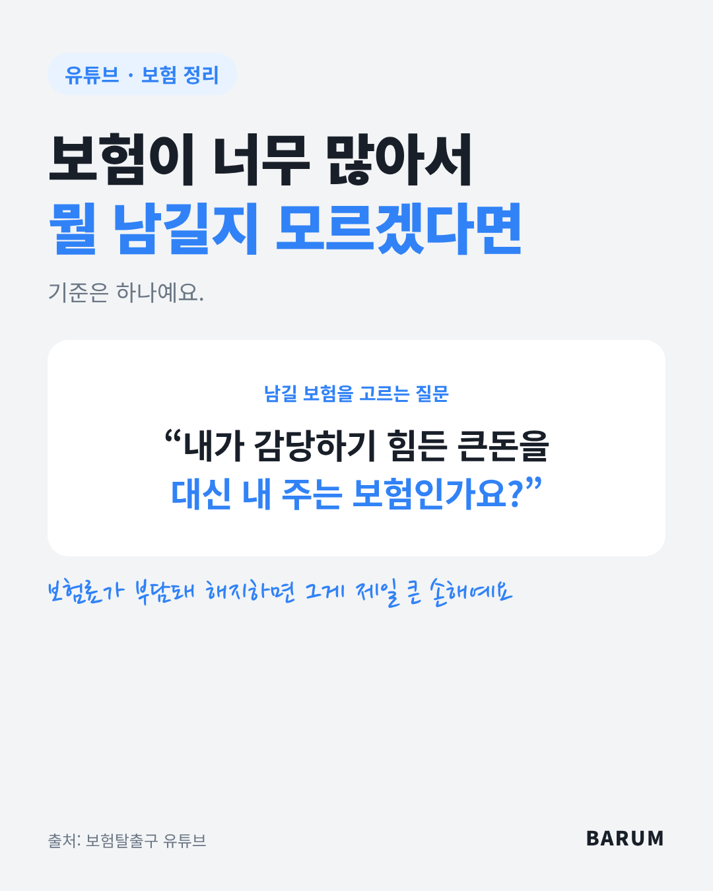
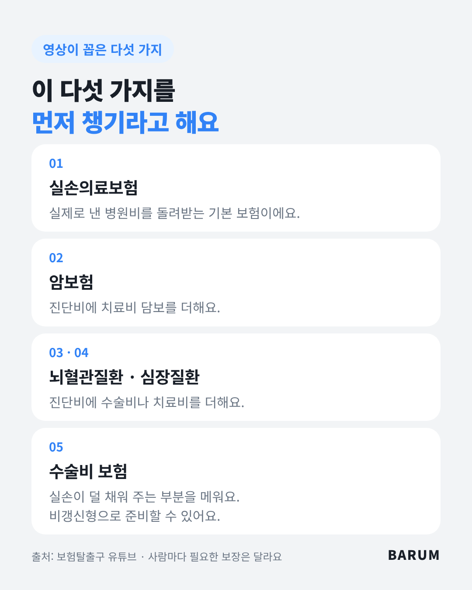
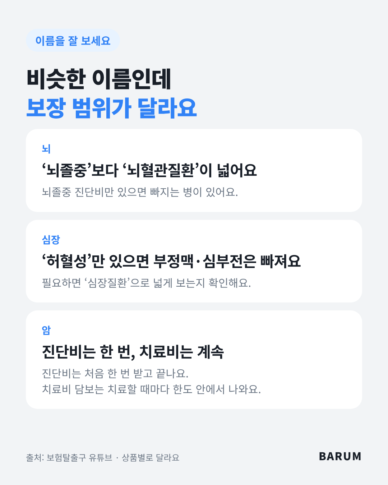
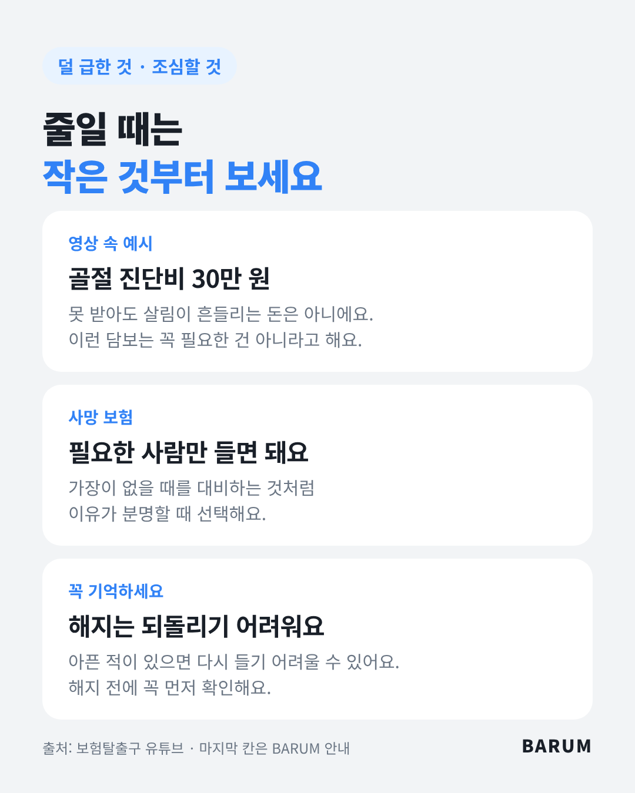
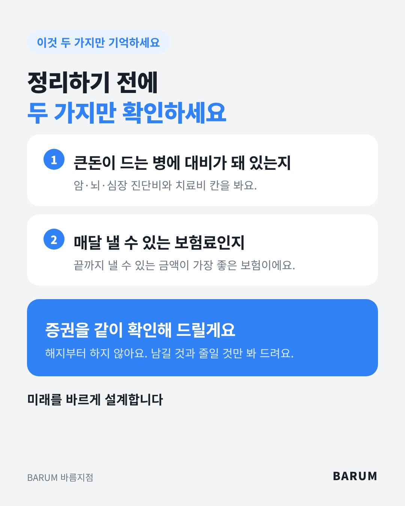

# 2026-11-19 오늘의 추천 영상

## 카드뉴스 (세로 1080×1350 · 고객 공유용)

카드 묶음 받기: https://raw.githubusercontent.com/bokkile83-ui/barum-news/main/yt/cards/2026-11-19_카드.zip

## 보험 정리 — 먼저 챙길 다섯 가지

- [“필수보험 5가지"만 남기고 전부 해지하세요. 돈 낭비일 수 있습니다.](https://www.youtube.com/watch?v=WG8EUa_AiTU)
- 한 줄: 「감당하기 힘든 큰돈을 대신 내 주는가」를 기준으로 먼저 챙길 보험 다섯 가지를 꼽는 영상(15분 25초).
- 채널: 보험탈출구 · 올린 날짜 2026-11-18

## 핵심 정리
- 보험을 고르는 기준은 「내가 감당하기 힘든 큰 경제적 위험을 대신 감당해 주는가」와 「일어날 가능성이 있는가」예요. (영상 앞부분)
- 영상이 꼽은 다섯 가지는 실손의료보험, 암보험, 뇌혈관질환 보험, 심장질환 보험, 수술비 보험이에요. (13:33)
- 암: 진단비는 처음 한 번 받고 끝나요. 재발·전이·긴 치료에 대비하려면 치료비 담보를 더해요. 영상 사례에서는 진단비 3,000만 원은 한 번, 치료비 1,000만 원은 치료 때마다 나왔어요. (07:38)
- 영상 화면 통계: 기대수명까지 살 때 암에 걸릴 확률은 남성 44.6%, 여성 38.2%예요. (05:59)
- 뇌: 「뇌졸중」보다 범위가 넓은 「뇌혈관질환 진단비」로 구성해요. 심장: 「허혈성 심장질환 진단비」는 부정맥·심부전을 보장하지 않아요. 필요하면 「심장질환 진단비」와 비교해요. (10:02)
- 수술비 보험은 실손의 빈 곳을 메워요. 비갱신형으로 준비할 수 있고, 입원·통원이나 급여·비급여를 가리지 않고 정해진 금액이 나와요. (12:03)
- 덜 급한 예로 골절 진단비 30만 원을 들어요. 못 받아도 살림이 흔들리는 돈이 아니라는 이유예요. 사망 보험은 필요가 분명한 사람만 선택하면 된다고 해요. (01:52)
- 보험료가 부담돼 중간에 해지하면 낸 돈도 손해고 정작 필요할 때 보장도 못 받아요. 매달 낼 수 있는 예산부터 정하라고 해요.
- 실손 재가입: 2013년 4월 이후 가입자는 15년 또는 5년 주기로 그때 판매 중인 실손으로 바뀐다고 설명해요. (12:15)

## 설계사에게
- 결론: 영상 제목은 「전부 해지하세요」지만, 상담에서는 「해지」가 아니라 「우선순위 정리」로 말해야 한다.
- 영상은 해지할 때의 위험(병력에 따른 재가입 거절, 부담보, 면책·감액 기간 다시 시작, 해지환급금 손실)을 거의 다루지 않는다. 고객이 이 영상을 보고 해지를 문의하면 이 네 가지를 먼저 설명한다. 카드 4번의 「해지는 되돌리기 어려워요」는 BARUM이 덧붙인 안내다.
- 기존 계약을 해지하고 새로 가입하게 할 때는 승환계약 비교안내 의무를 지킨다. 새 계약 인수가 확정되기 전에 기존 계약을 해지하게 하지 않는다.
- 「다섯 가지」는 이 채널의 의견이다. 가족 구성·소득·기존 보장에 따라 사망 보장이나 간병 보장이 더 급한 고객도 있다.
- [확인] 5세대 실손 숫자(비급여 비중증 연 1,000만 원, 통원 회당 20만 원, 자기부담 50%)와 재가입 주기는 영상 화면 기준이다. 금융당국 자료로 확인 후 말한다.
- 영상의 설계 예시 보험료(35세 남성 월 31,260원 등)와 상담 연락처는 옮기지 않았다.

## 오늘 고객에게 한마디
> 「보험을 줄이고 싶으실 땐 해지부터 하지 마시고, 큰돈이 드는 병에 대비가 돼 있는지부터 같이 봐요. 남길 것과 줄일 것을 증권 보면서 정리해 드릴게요.」

— BARUM 바름지점

> 내용은 회사·상품마다 다를 수 있으니 공식 자료와 같이 본다.
