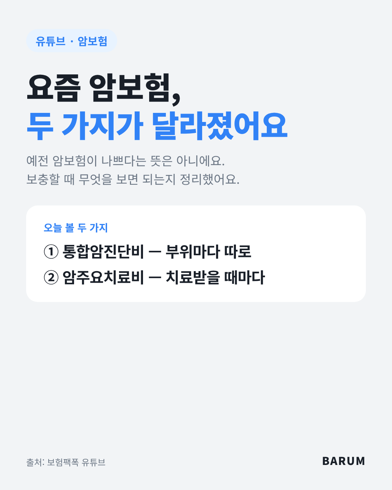
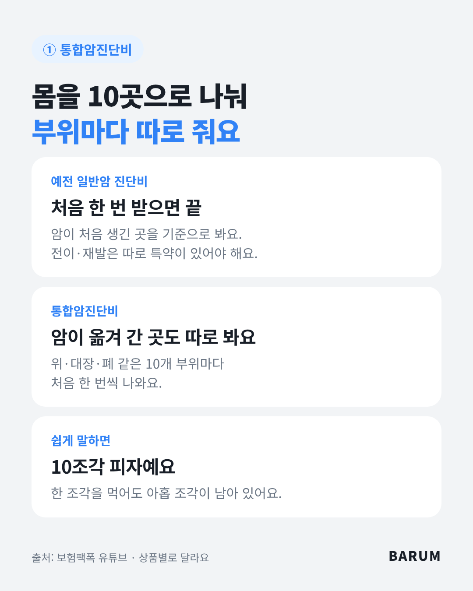
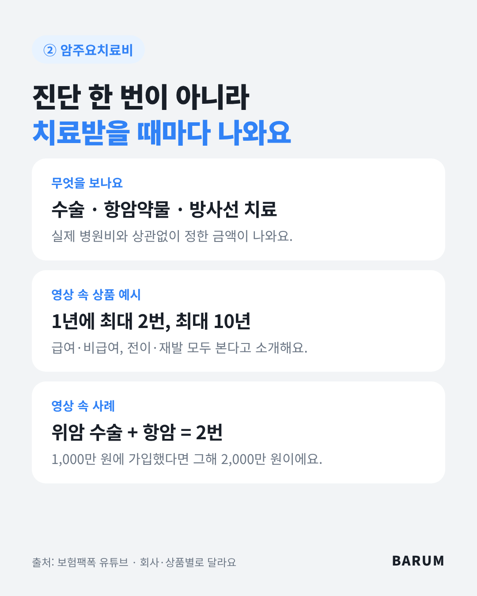
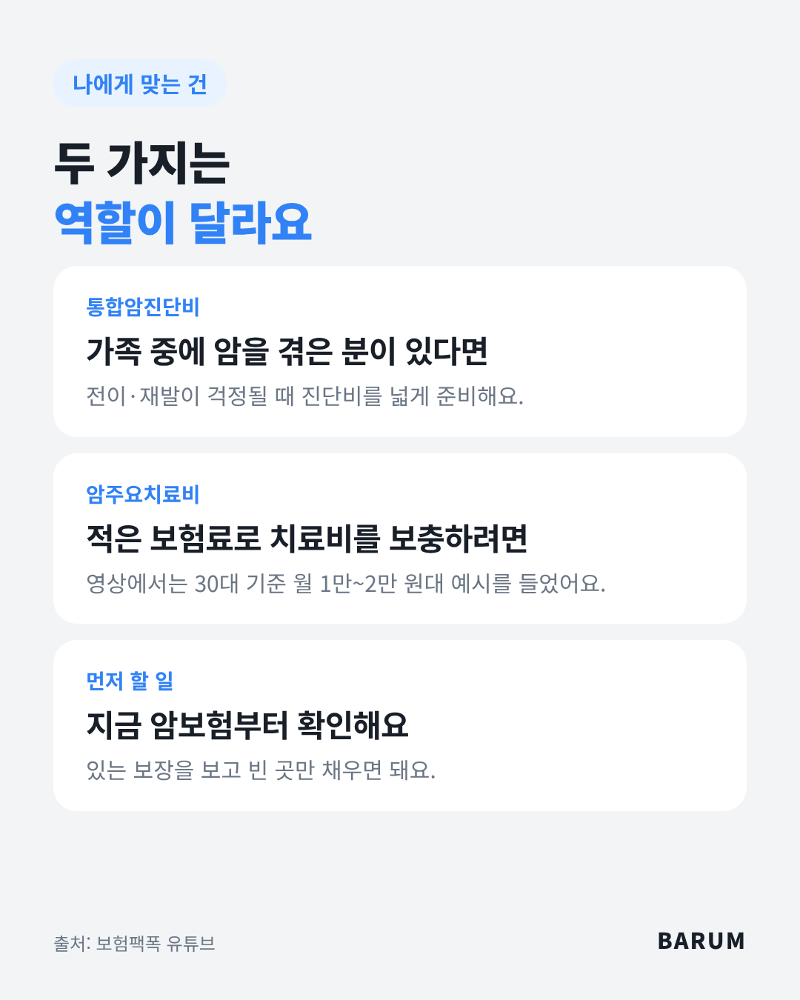
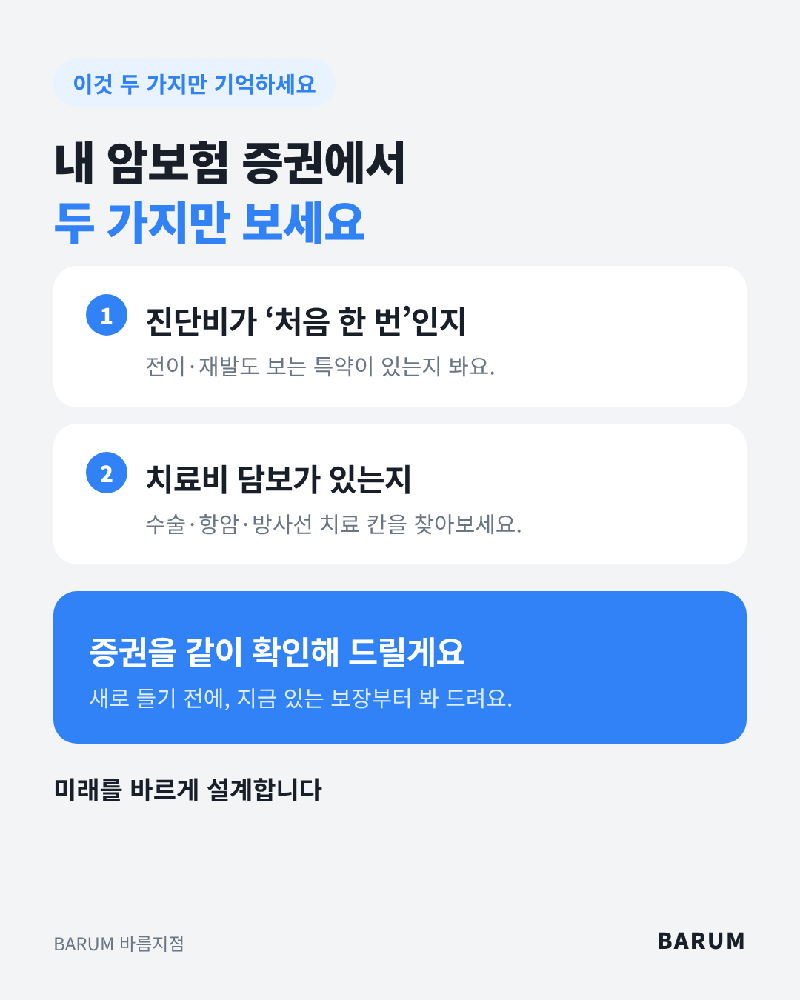

# 2026-11-20 오늘의 추천 영상

## 카드뉴스 (세로 1080×1350 · 고객 공유용)

카드 묶음 받기: https://raw.githubusercontent.com/bokkile83-ui/barum-news/main/yt/cards/2026-11-20_카드.zip

## 암보험 — 통합암진단비와 암주요치료비

- [암보험 상품 최신 트랜드 2가지만 비교하시면 됩니다](https://www.youtube.com/watch?v=fm4KXJovaK8)
- 한 줄: 요즘 암보험의 두 흐름(통합암진단비, 정액형 암주요치료비)을 예전 일반암 진단비와 비교하는 영상(12분 18초).
- 채널: 보험팩폭 · 올린 날짜 2026-11-19

## 핵심 정리
- 예전 일반암 진단비는 처음 한 번 받으면 끝나요. 암이 처음 생긴 곳(원발암) 기준이라 전이·재발은 따로 특약이 있어야 해요. (00:58)
- 통합암진단비는 몸을 10개 부위로 나눠 부위마다 처음 한 번씩 줘요. 암이 옮겨 간 곳(도착지)을 기준으로 봐요. 「10조각 피자」로 비유해요. (01:12~03:37)
- 영상 사례: 갑상선암이 위·간·대장·폐로 전이되면, 예전 방식은 유사암 진단비 한 번, 통합암진단비는 부위마다 따로 나온다고 설명해요. (02:52)
- 다른 부위에 생기면 재진단암 특약처럼 기다리는 기간 없이 부위별로 본다고 해요. (04:31)
- 암주요치료비는 수술·항암약물·방사선 같은 치료를 받을 때 정한 금액을 줘요. 실제 병원비와 상관없는 정액형이에요. 영상 속 상품은 1년에 최대 2번, 최대 10년, 급여·비급여와 전이·재발을 모두 본다고 소개해요. (04:57~07:23)
- 영상에서는 지금 비례형은 판매가 중단되고 정액형만 가입할 수 있다고 말해요. (06:04)
- 영상 사례: 1,000만 원 가입 시 위암 수술 + 항암을 같은 해에 받으면 2,000만 원. 8년 차에 다른 암으로 수술 + 항암을 받아도 2,000만 원. (07:25)
- 결론: 예전 암보험이 나쁜 게 아니에요. 보충하고 싶을 때 진단비만 더 넣기보다 이 두 가지를 보고 빈 곳을 채우라고 해요. (11:03)

## 설계사에게
- 결론: 통합암진단비는 「부위별 진단비」, 암주요치료비는 「치료 행위별 치료비」다. 고객의 기존 암보험에서 빠진 것이 무엇인지부터 확인하고 하나를 고른다.
- 통합암진단비: 회사마다 부위 나누는 방식, 소액암 처리, 같은 부위 재발 보장 여부가 다르다. 「전이되면 다 받는다」고 단정하지 않는다.
- 암주요치료비: 영상은 특정 회사(A사) 정액형 기준이다. 연간 지급 횟수, 보장 기간(10년 등), 갱신 여부, 소액암 금액, 면책·감액 기간은 상품마다 다르다. 11/18 유튜브 글(비급여 암 치료비 13개사 비교)과 같이 본다.
- [확인] 「비례형 판매 중단」, 「연간 최대 2회·최대 10년」은 영상 기준이다. 판매 중인 상품 약관으로 확인한 뒤 말한다.
- 영상의 연령별 보험료 표와 상담 연락처는 옮기지 않았다. 영상 화면의 광고 심의필 유효기간(2026.03.16)이 이미 지났다는 점도 참고한다.

## 오늘 고객에게 한마디
> 「요즘 암보험은 진단비를 부위마다 따로 주거나, 치료받을 때마다 주는 방식이 생겼어요. 새로 드시기 전에, 지금 있는 암보험에서 빈 곳이 어디인지부터 같이 봐요.」

— BARUM 바름지점

> 내용은 회사·상품마다 다를 수 있으니 공식 자료와 같이 본다.
