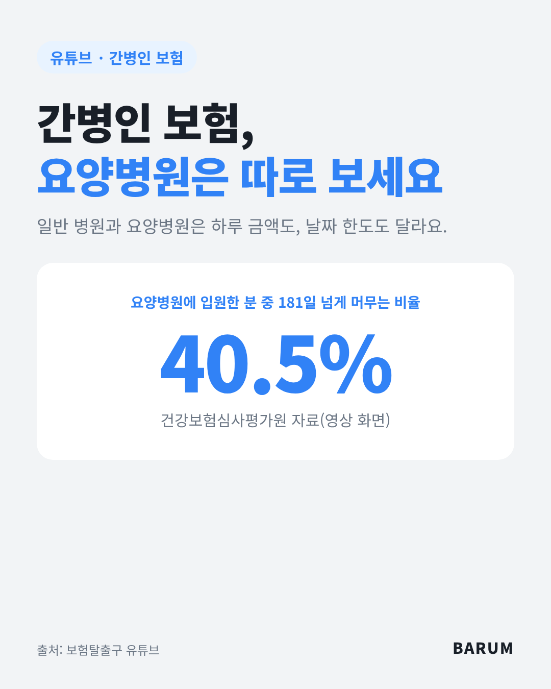
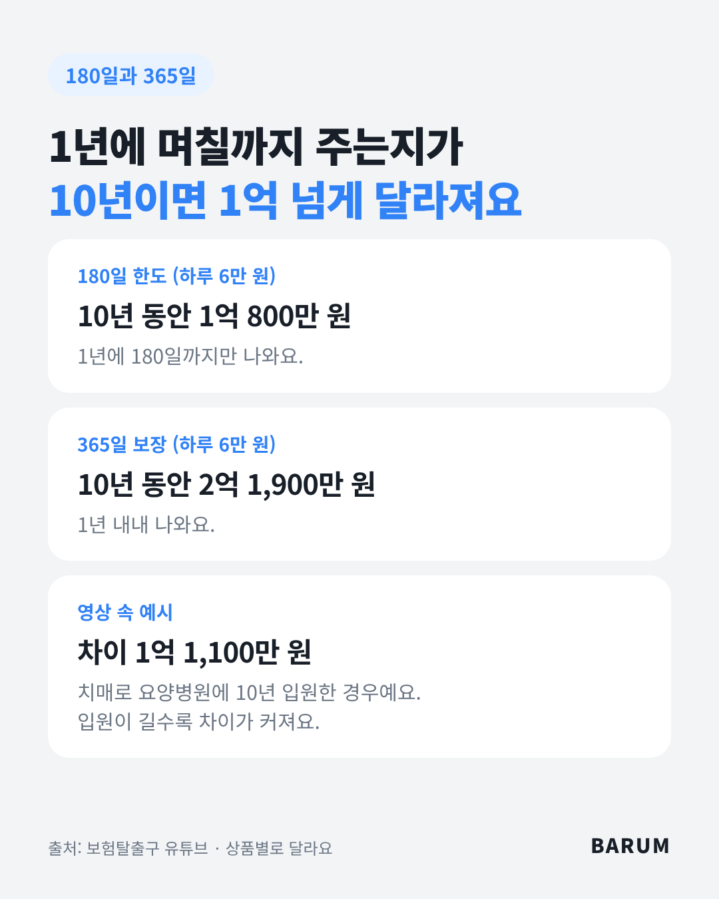
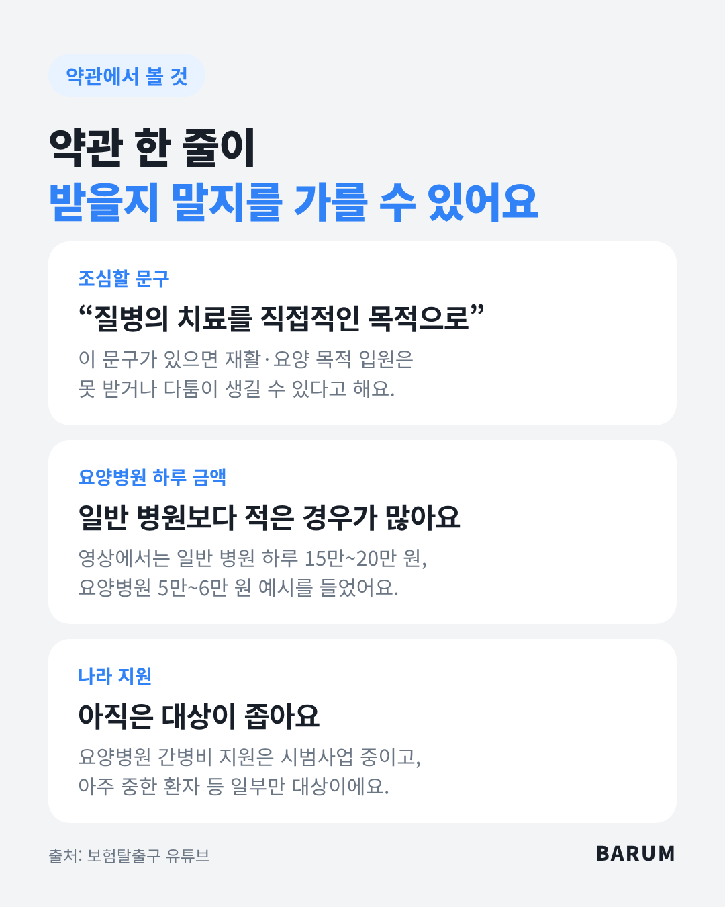
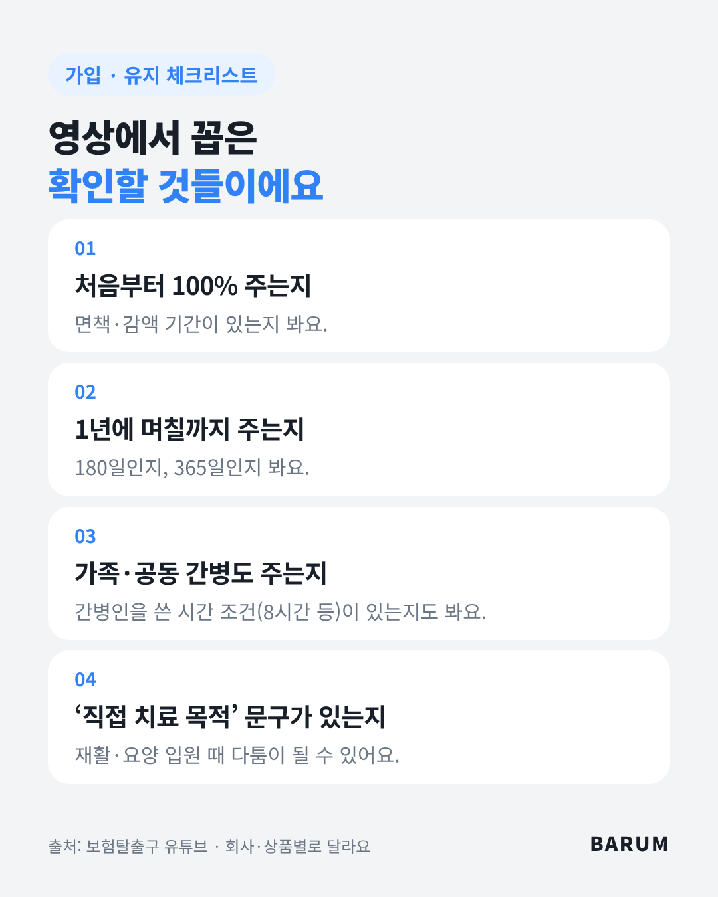
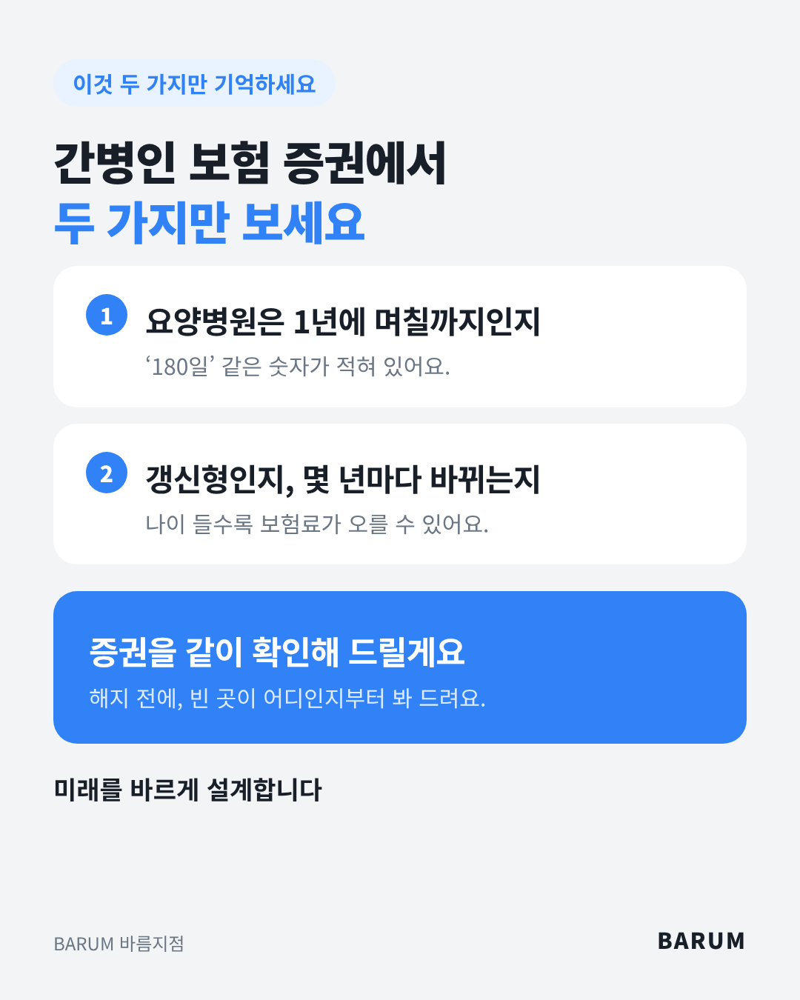

# 2026-11-21 오늘의 추천 영상

## 카드뉴스 (세로 1080×1350 · 고객 공유용)

카드 묶음 받기: https://raw.githubusercontent.com/bokkile83-ui/barum-news/main/yt/cards/2026-11-21_카드.zip

## 간병인 보험 — 요양병원 보장은 따로 확인

- [간병인 보험 결국 '이것"때문에 해지 합니다..](https://www.youtube.com/watch?v=2le97U5fR7I)
- 한 줄: 간병인 보험의 요양병원 보장 한도(180일·365일)와 약관 문구, 가입·유지 때 확인할 것을 정리한 영상(14분 1초).
- 채널: 보험탈출구 · 올린 날짜 2026-11-12

## 핵심 정리
- 일반 병원은 하루 15만~20만 원을 주는 상품이 많지만, 요양병원은 하루 5만~6만 원이고 1년에 180일까지로 제한하는 경우가 많다고 해요. (00:00)
- 영상 속 예시: 치매로 요양병원에 10년 입원해 공동 간병인을 쓴 경우, 하루 6만 원 기준 180일 한도형은 1억 800만 원, 365일 보장형은 2억 1,900만 원. 차이는 1억 1,100만 원이에요. (00:00~01:31)
- 영상 화면(건강보험심사평가원 자료): 요양병원 입원 환자 중 181일 넘게 머무는 비율 평균 40.5%. 치매, 편마비, 뇌경색, 파킨슨병 등이 많아요. (01:31)
- 나라의 요양병원 간병비 지원은 시범사업을 거쳐 2027년 1월 본사업 전환 계획이지만, 의료최고도·고도이면서 장기요양 1·2등급인 환자, 지정된 병원만 대상이라고 설명해요. (04:26)
- 약관에 「질병의 치료를 직접적인 목적으로」 입원해야 한다는 문구가 있으면 재활·요양 목적 입원은 못 받거나 다툼이 생길 수 있다고 해요. 이 문구가 없는 상품도 있어요. (05:39)
- 체크리스트: 면책·감액 기간 없이 처음부터 100%인지, 8시간 같은 사용 시간 조건이 없는지, 365일 보장인지, 가족·공동 간병도 주는지, 직접 치료 목적 문구가 없는지, 상해·질병 구분 없이 주는지. (13:05)

## 설계사에게
- 결론: 간병인 보험 상담은 「하루 얼마」보다 「요양병원 1년 한도 일수」와 「직접 치료 목적 문구」를 먼저 본다.
- 기존 고객 점검: 증권에서 요양병원 한도(180일/365일)와 갱신 주기(3년·10년·20년)를 확인한다. 갱신형은 나이가 들수록 보험료가 오를 수 있다는 점을 같이 설명한다.
- 영상 제목은 「해지」를 말하지만, 해지 전에 새 계약 인수 가능 여부·병력 고지·면책 기간을 반드시 먼저 확인한다. 간병 보장은 고령일수록 다시 들기 어렵다.
- [확인] 요양병원 간병비 국가 지원 일정(2027년 1월 본사업)과 대상 기준, 181일 이상 입원 비율 40.5%는 영상 화면 기준이다. 보건복지부·심평원 자료로 확인한 뒤 말한다.
- 영상의 회사별 보험료 비교(A~D사)와 체증형 상품 금액, 상담 연락처는 옮기지 않았다.

## 오늘 고객에게 한마디
> 「간병인 보험은 요양병원에서 1년에 며칠까지 나오는지가 중요해요. 증권에 적힌 숫자 하나만 같이 확인해 봐요.」

— BARUM 바름지점

> 내용은 회사·상품마다 다를 수 있으니 공식 자료와 같이 본다.
