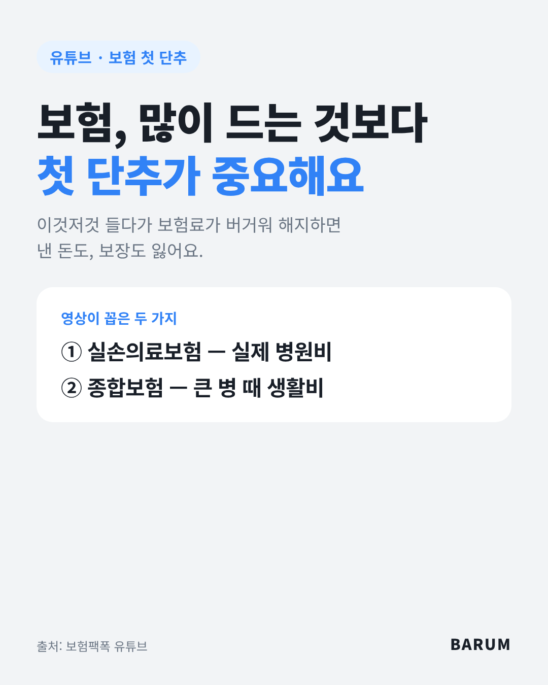
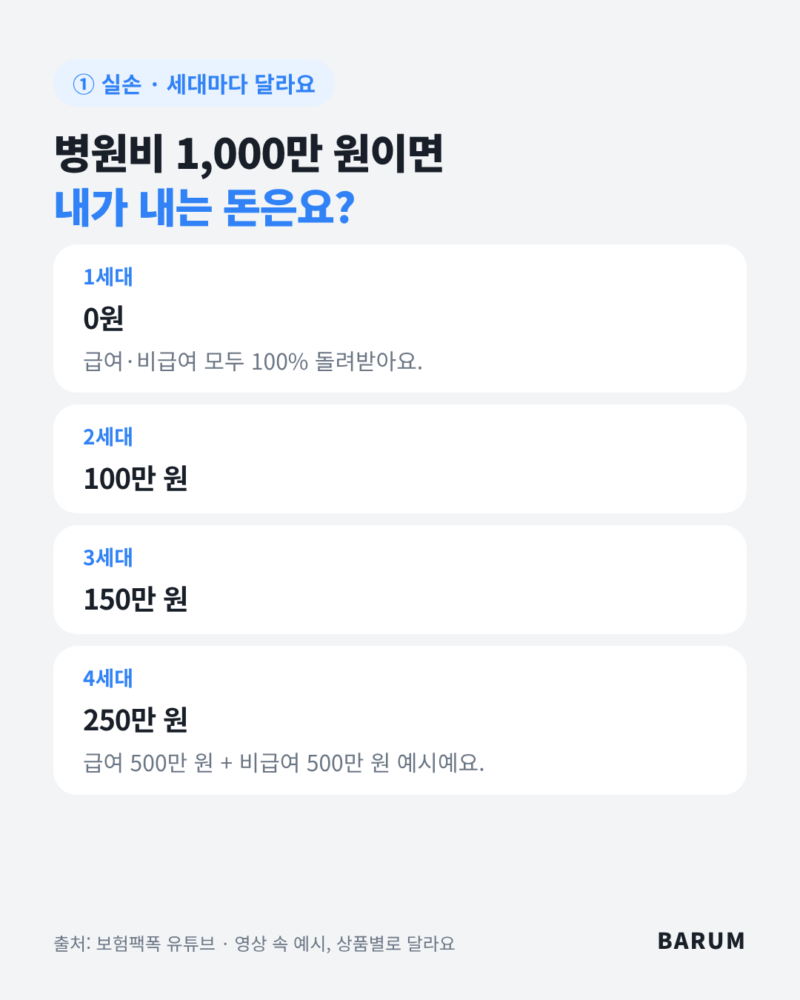
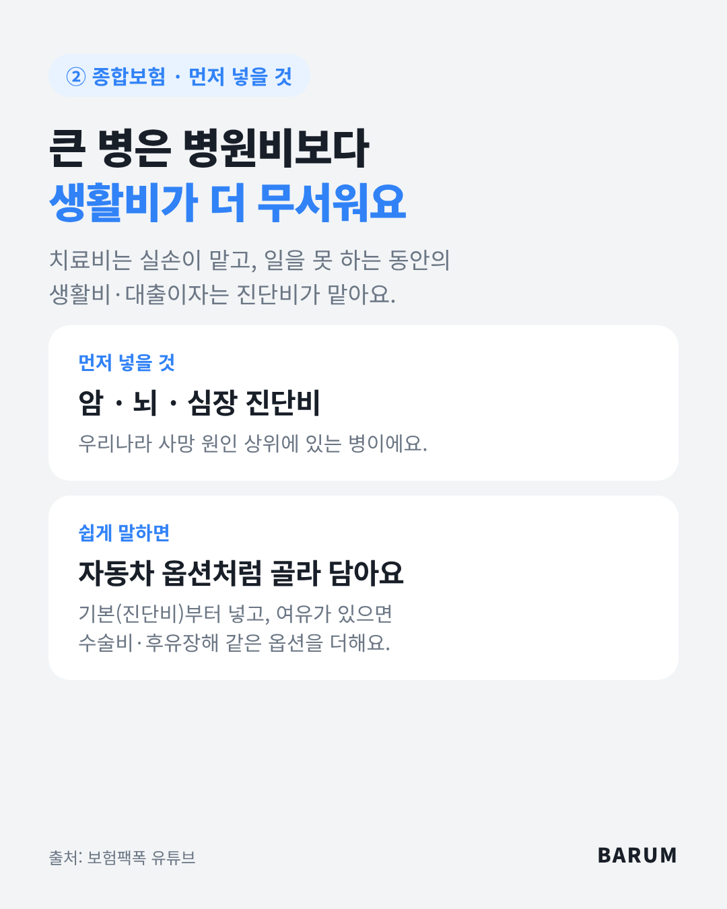
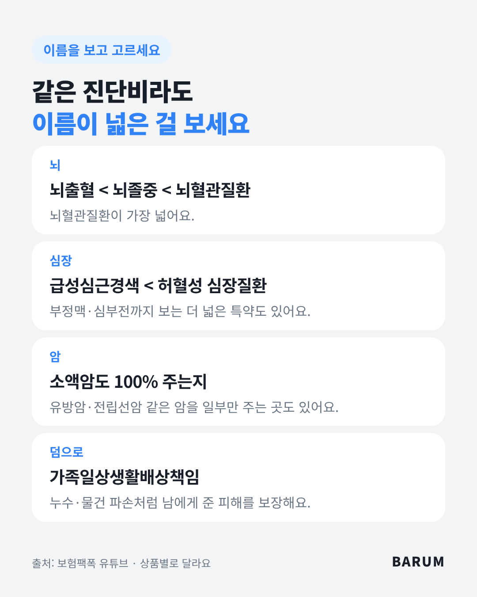
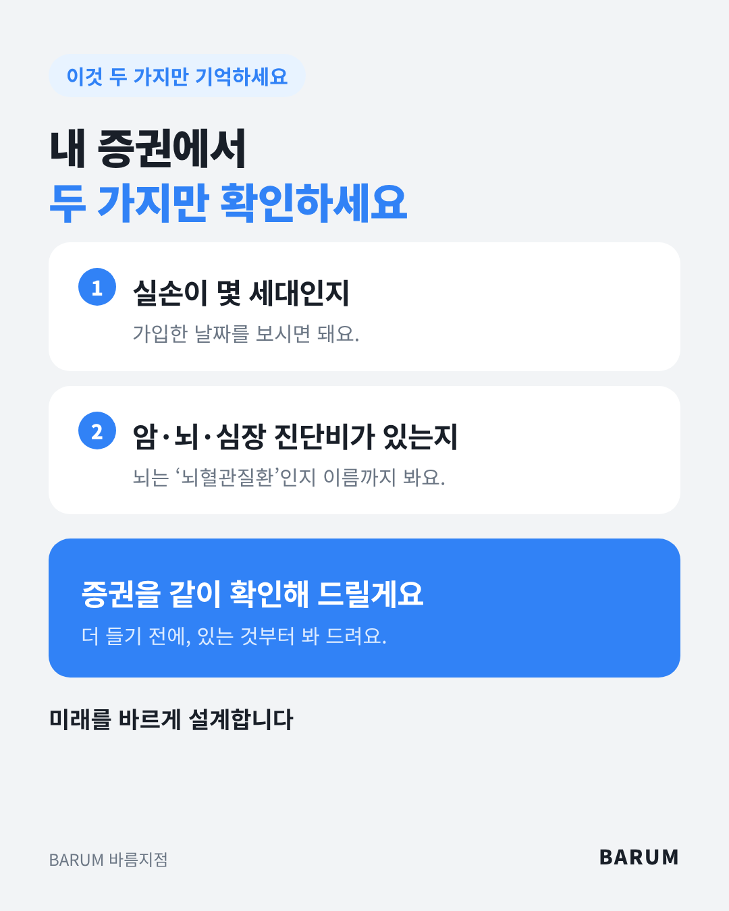

# 2026-11-22 오늘의 추천 영상

## 카드뉴스 (세로 1080×1350 · 고객 공유용)

카드 묶음 받기: https://raw.githubusercontent.com/bokkile83-ui/barum-news/main/yt/cards/2026-11-22_카드.zip

## 보험 첫 단추 — 실손과 종합보험

- [종합보험 추천 건강종합보험 성인까지 필수보장 2가지 꼭 가져가세요(설계 상품 가입)](https://www.youtube.com/watch?v=hWCMEaQnl40)
- 한 줄: 처음 보험을 준비할 때 실손의료보험과 종합보험(진단비 중심) 두 가지를 기본으로 잡고, 특약 이름을 보고 고르는 법을 설명하는 영상(19분 54초).
- 채널: 보험팩폭 · 올린 날짜 2026-11-17

## 핵심 정리
- 이것저것 가입하다 보험료가 버거워 해지하면 낸 돈도, 보장도 잃는다고 해요. 첫 단추가 중요해요. (00:00)
- 실손의료보험은 실제 병원비를 돌려받는 기본 보험이에요. 영상 예시(병원비 1,000만 원, 급여·비급여 각 500만 원)에서 내가 내는 돈은 1세대 0원, 2세대 100만 원, 3세대 150만 원, 4세대 250만 원이에요. (03:43)
- 건강검진, 영양제, 미용 목적 시술 등은 실손에서 보장하지 않아요. (05:12)
- 종합보험은 자동차 옵션처럼 특약을 골라 담는 보험이에요. 먼저 넣을 것은 암·뇌·심장 진단비예요. 큰 병은 치료비보다 일을 못 하는 동안의 생활비·대출이자가 더 큰 부담이라는 이유예요. (05:49~07:07)
- 이름을 보고 고르세요. 뇌는 뇌출혈 < 뇌졸중 < 뇌혈관질환, 심장은 급성심근경색 < 허혈성 심장질환 < 더 넓은 심혈관 특약 순으로 범위가 넓어요. (12:49~14:07)
- 암은 유방암·전립선암 같은 소액암을 100% 주는지, 대장점막내암을 일반암으로 보는지 확인하라고 해요. (11:24)
- 여유가 있으면 수술비, 후유장해(3% 이상 하나로 50%·80% 포함), 항암치료비, 가족일상생활배상책임(월 1,000~2,000원 수준)을 더해요. (07:19~10:35)

## 설계사에게
- 결론: 첫 보험 상담은 「실손 세대 확인 → 암·뇌·심장 진단비 범위 확인」 순서로 한다. 그다음에 예산 안에서 특약을 더한다.
- 영상은 실손을 4세대까지만 설명한다. 5세대 실손 출시(영상 기준 2026년 5월) 이후 신규 가입 조건은 따로 확인해서 안내한다.
- 「4세대는 회사마다 보장이 같으니 보험료가 싼 곳」이라는 설명은 표준약관 기준이다. 갱신 보험료 흐름과 회사별 인수 기준은 다를 수 있다.
- 사망 보장이 필요한 가장에게는 영상에서 정기보험을 예로 든다. 고객 가족 구성에 따라 종신·정기를 비교해서 설명한다.
- [확인] 사망 원인 순위 통계, 소액암·대장점막내암 처리는 상품마다 다르다. 약관으로 확인한다.
- 영상의 연령별 보험료 예시와 상담 연락처는 옮기지 않았다.

## 오늘 고객에게 한마디
> 「보험은 많이 드는 것보다 첫 단추가 중요해요. 실손이 몇 세대인지, 암·뇌·심장 진단비가 있는지 두 가지부터 같이 볼까요?」

— BARUM 바름지점

> 내용은 회사·상품마다 다를 수 있으니 공식 자료와 같이 본다.
