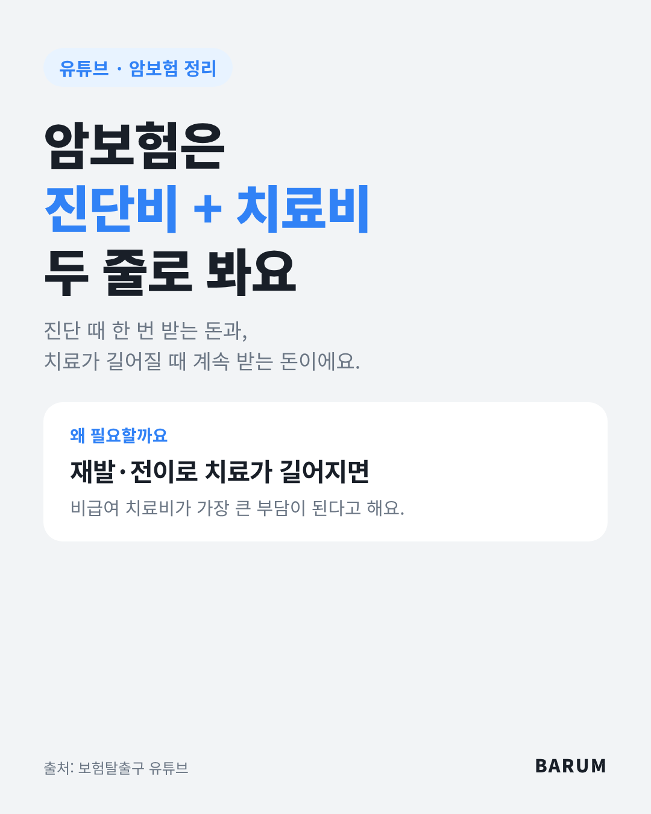
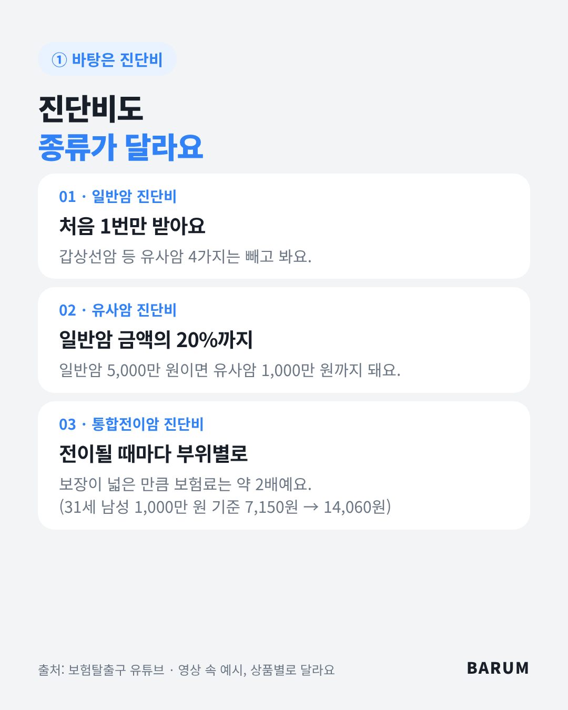
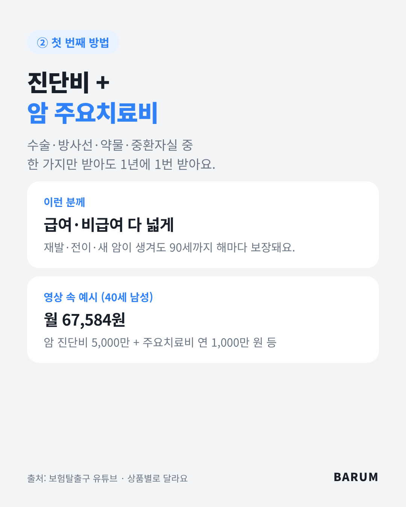
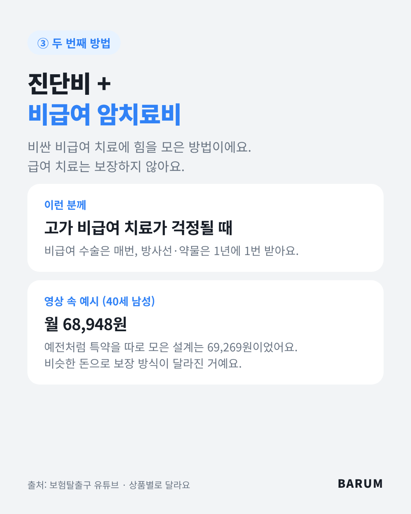
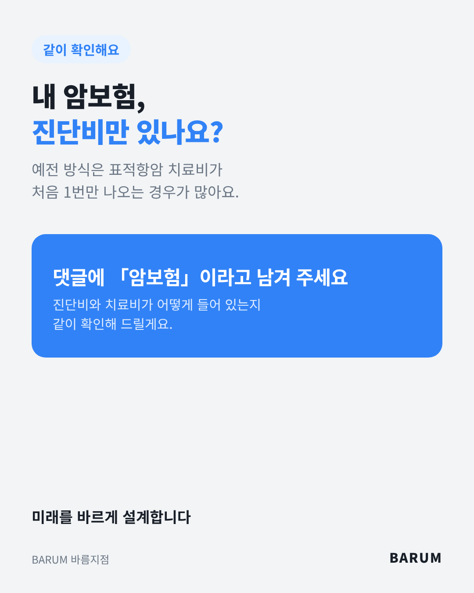

# 2026-11-23 오늘의 추천 영상

## 카드뉴스 (세로 1080×1350 · 고객 공유용)

카드 묶음 받기: https://raw.githubusercontent.com/bokkile83-ui/barum-news/main/yt/cards/2026-11-23_카드.zip

## 암보험 — 진단비 + 치료비 두 가지 설계

- [사실 암보험은 이 "2가지"면 끝입니다..! 이걸 몰라서 비싸게 가입하는거에요.](https://www.youtube.com/watch?v=oXqbGZBgA8Y)
- 한 줄: 암보험을 「진단비 + 주요치료비」 또는 「진단비 + 비급여 치료비」 두 가지로 짜는 법과, 예전 방식 설계가 비싼 이유를 설명하는 영상(11분 51초).
- 채널: 보험탈출구 · 올린 날짜 2026-11-06

## 핵심 정리
- 감당할 수 있는 작은 병원비보다, 재발·전이로 길어지는 고가 비급여 치료가 암의 가장 큰 위험이라고 해요. (01:39~03:04)
- 일반암 진단비는 유사암 4가지(갑상선암·기타피부암·경계성종양·제자리암)를 빼고 처음 1번만 줘요. 유사암 진단비는 일반암의 20%까지 들 수 있어요. (03:06~04:09)
- 통합전이암 진단비는 전이될 때마다 부위별로 줘요. 보험료는 약 2배예요(31세 남성 1,000만 원 기준 일반암 7,150원 vs 통합전이암 14,060원, 여성 5,350원 vs 10,500원). (04:24~04:41)
- 방법 1, 진단비 + 암 주요치료비: 수술·방사선·약물·중환자실 중 1가지만 받아도 연 1회 지급, 급여·비급여 상관없이 90세까지 매년. 40세 남성 예시 월 67,584원. (05:11~08:00)
- 참고로 복합치료비는 2가지 이상 병용이면 100%, 3가지 이상이면 150%를 주는 방식이에요. (05:38~06:01)
- 방법 2, 진단비 + 비급여 암치료비: 비급여 수술 매회 2,000만 원, 비급여 방사선·약물 연 1회 2,000만 원, 급여 치료는 보장 안 해요. 40세 남성 예시 월 68,948원. 구성에 따라 연 최대 1억 2,000만 원까지. (09:16~10:22)
- 예전 방식(수술비·표적항암 최초 1회·방사선 등 특약을 따로 묶음)은 40세 남성 월 69,269원으로, 비슷한 돈에 보장 조건은 불리하다고 해요. (08:26~09:00)

## 설계사에게
- 결론: 암보험 점검은 「진단비 종류(일반·유사·통합전이)」 → 「치료비가 있는지, 1회성인지 반복인지」 순서로 본다.
- 표적항암 최초 1회 같은 예전 특약만 있는 고객은 치료비 보장이 1번으로 끝나는지 확인하게 한다.
- 두 방법은 고객 성향으로 고른다. 급여·비급여 넓게 반복 보장이면 주요치료비, 고가 비급여 집중이면 비급여 치료비다.
- 영상 보험료는 40세 남성·상해1급·20년납 90세만기 예시다. 실제 금액은 우리 회사 설계로 다시 뽑는다.
- 이 영상은 11/23(월) 예약분이 빠져 11/24에 채워 올렸다.

## 오늘 고객에게 한마디
> 「암보험은 진단 때 받는 돈과 치료가 길어질 때 받는 돈, 두 줄로 보시면 돼요. 지금 가지신 보험이 어느 쪽인지 같이 봐 드릴게요.」

— BARUM 바름지점

> 내용은 회사·상품마다 다를 수 있으니 공식 자료와 같이 본다.
