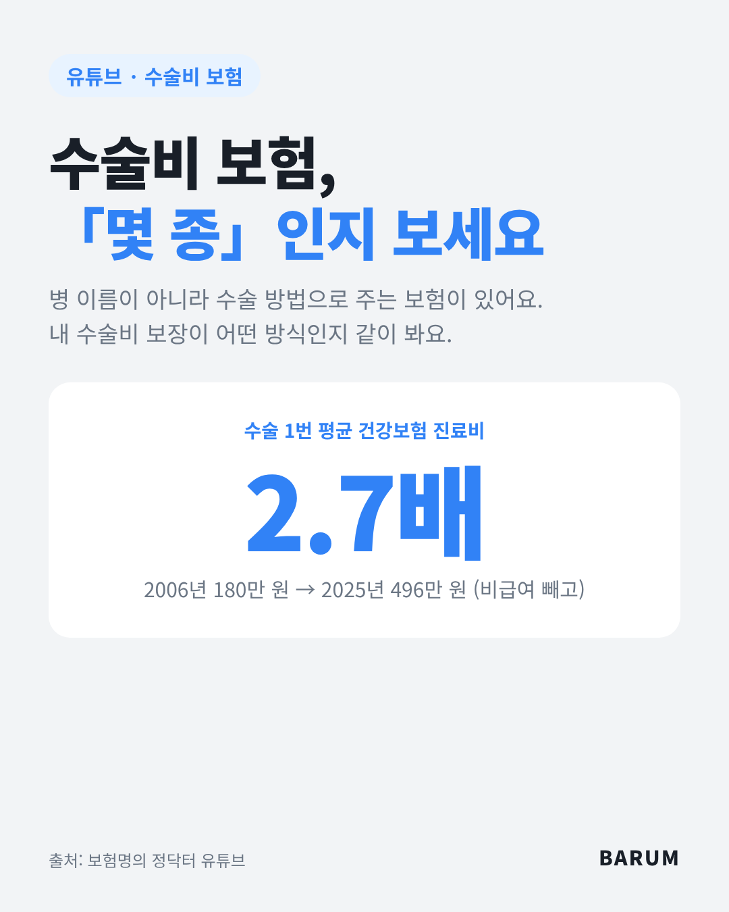
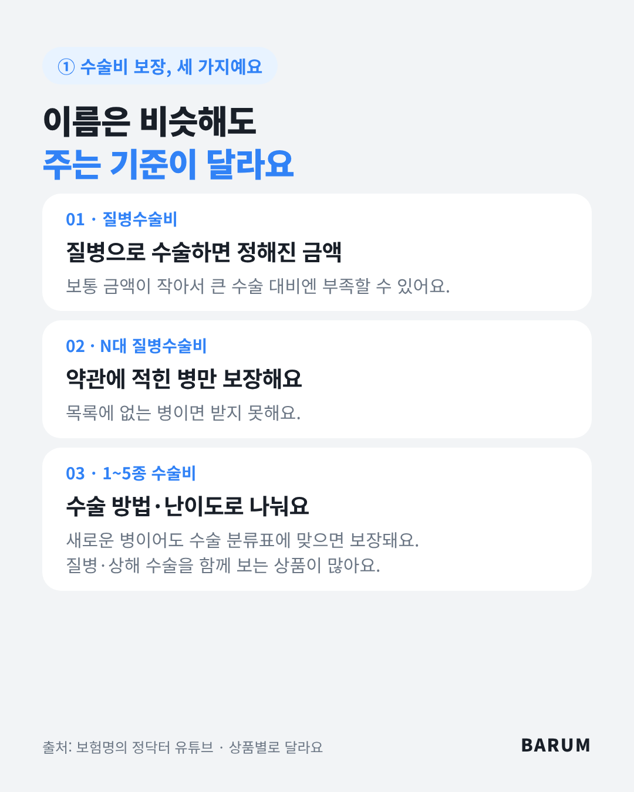
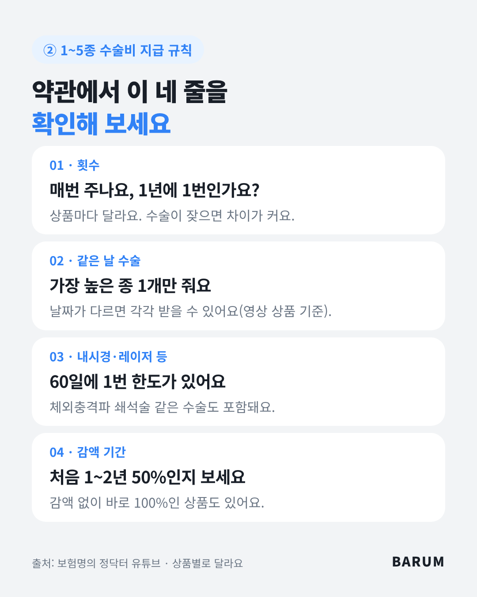
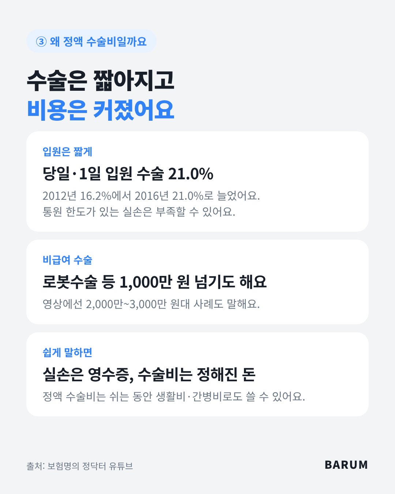
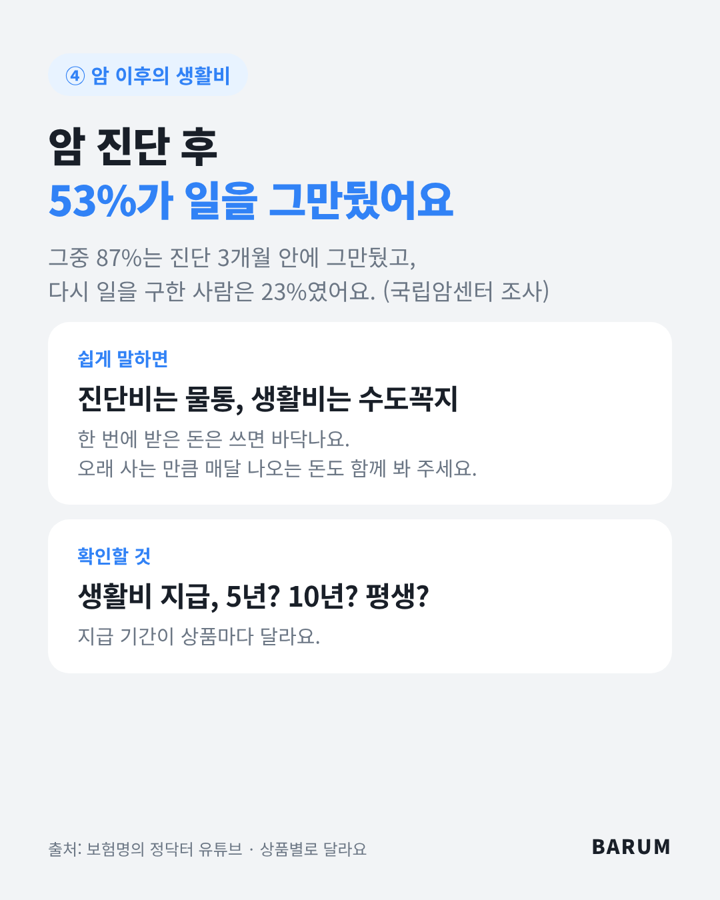
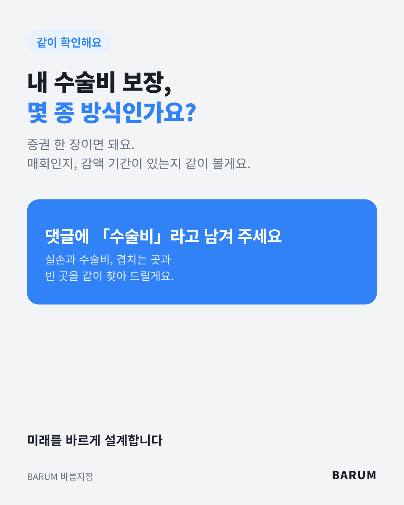

# 2026-11-24 오늘의 추천 영상

## 카드뉴스 (세로 1080×1350 · 고객 공유용)

카드 묶음 받기: https://raw.githubusercontent.com/bokkile83-ui/barum-news/main/yt/cards/2026-11-24_카드.zip

## 수술비 보험 — 1~5종 수술비와 정액 보장

- [2027년부터 수술비 혼합설계 불가능!? 도대체 무슨 일이?](https://www.youtube.com/watch?v=6cNy63uh_u8)
- 한 줄: 수술비 보장 종류(질병·N대·1~5종)의 차이, 정액 수술비가 필요한 이유, 암 이후 생활비 보장을 설명하는 라이브 강의(1시간). 상당 부분이 특정 회사 상품 비교·상담 유도라 그 부분은 뺐다.
- 채널: 보험명의 정닥터 · 올린 날짜 2026-11-13

## 핵심 정리
- 영상은 당국의 가입 한도 누적 관리로 여러 회사 수술비를 묶는 「혼합설계」가 2027년부터 어려워질 거라고 전망해요. 공식 발표가 아니라 영상 속 전망이에요. (00:08~03:44)
- 수술비 보장은 세 가지예요. 질병수술비는 금액이 작고(보통 40만 원 이하), N대 질병수술비는 약관에 적힌 병만, 1~5종 수술비는 수술 방법·난이도(수술 분류표)로 줘서 새로운 병도 보장될 수 있어요. (25:10~28:40)
- 1~5종 수술비 규칙(영상 상품 기준): 수술할 때마다 지급, 같은 날 여러 수술은 가장 높은 종 1개, 내시경·체외충격파 쇄석술·레이저 수술은 60일에 1회. 감액 기간이 없는 상품도 있어요. (31:00~33:40, 05:43)
- 수술 1회 평균 건강보험 진료비는 2006년 180만 원에서 2025년 496만 원으로 약 2.7배가 됐어요. 비급여는 빠진 숫자예요. 로봇수술 같은 비급여 수술은 1,000만 원 넘게, 2,000만~3,000만 원대도 있다고 해요. (16:16~18:37)
- 수술 환자 평균 입원일은 6.55일(2006) → 5.93일(2016)로 줄고, 당일·1일 입원 수술 비중은 16.2%(2012) → 21.0%(2016)로 늘었어요. 통원 한도가 있는 실손으로는 부족할 수 있어요. (24:50~25:05)
- 영상이 말하는 5세대 실손: 중증 아닌 비급여 연간 한도 1,000만 원, 자기부담 50%, 통원 하루 20만 원. (20:00~21:05)
- 암 5년 생존율은 20년 전 54.2%에서 지금 73.7%로 올랐어요. 전이암 5년 생존율은 27.8%예요. (43:25~49:00)
- 국립암센터 조사: 암 진단 후 53%가 일을 그만두고, 그중 87%는 3개월 안에, 재취업은 23%예요. 진단비(물통)만이 아니라 매달 나오는 생활비(수도꼭지)도 보라고 해요. (50:27~51:40)

## 설계사에게
- 결론: 수술비 상담은 「고객 증권의 수술비가 질병·N대·1~5종 중 무엇인지」부터 확인한다. 그다음 매회/연 1회, 감액 기간, 같은 날 수술 규칙을 본다.
- 「실손 있어서 괜찮다」는 고객에게는 통원 한도와 자기부담을 숫자로 보여 준다. 실손 세대마다 다르니 고객 실손 세대부터 확인한다.
- 「2027년 혼합설계 불가」는 영상 속 전망이다. 확정된 제도처럼 말하지 않는다. 절판 마케팅으로 쓰지 않는다.
- 영상의 특정 회사 설계안·보험료는 시점과 회사에 따라 바뀐다. 상담에는 우리 회사 최신 자료를 쓴다.
- 암 상담에서는 진단비 금액과 함께 생활비형 보장의 지급 기간(5년·10년·종신)을 확인하게 한다.

## 오늘 고객에게 한마디
> 「수술비 보험은 이름이 비슷해도 주는 기준이 달라요. 증권 한 장만 보여 주시면 몇 종 방식인지, 매번 나오는지 같이 확인해 드릴게요.」

— BARUM 바름지점

> 내용은 회사·상품마다 다를 수 있으니 공식 자료와 같이 본다.
