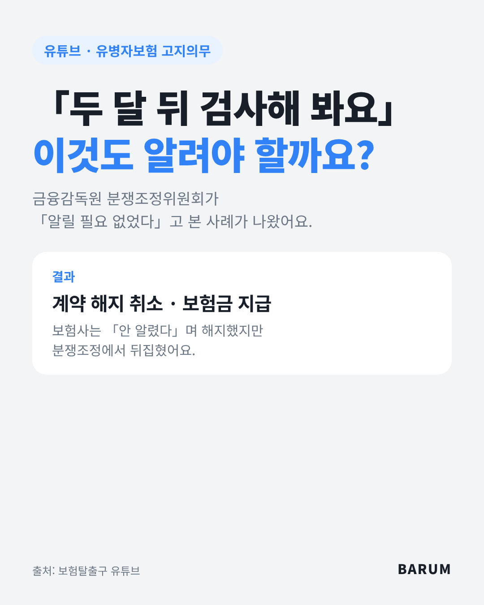
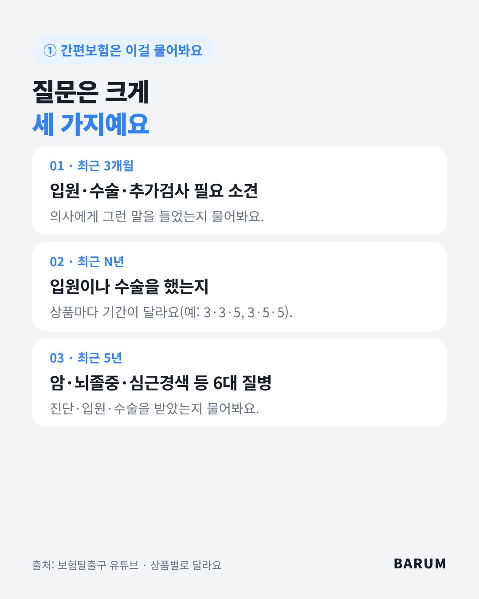
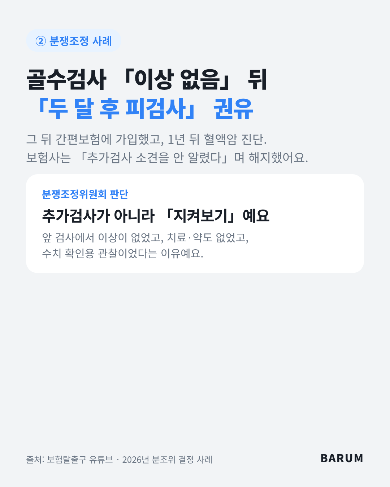
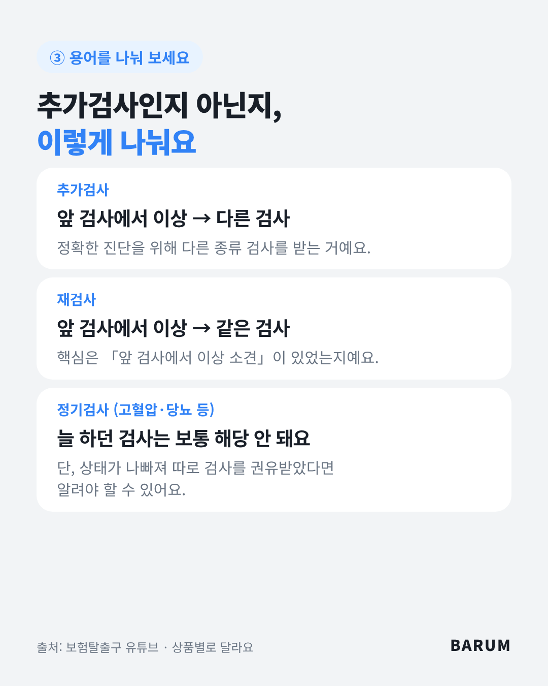
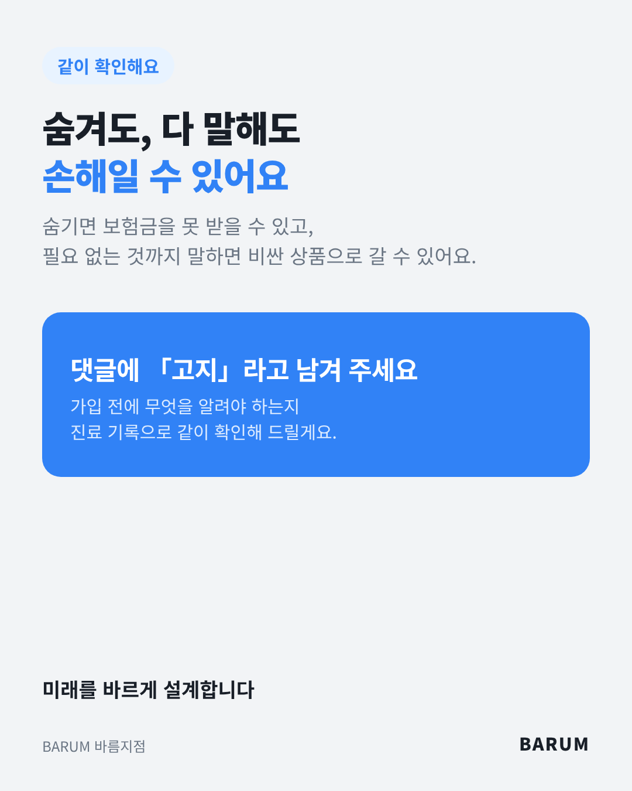

# 2026-11-25 오늘의 추천 영상

## 카드뉴스 (세로 1080×1350 · 고객 공유용)

카드 묶음 받기: https://raw.githubusercontent.com/bokkile83-ui/barum-news/main/yt/cards/2026-11-25_카드.zip

## 유병자(간편)보험 고지의무 — 분쟁조정 사례

- [유병자보험 고지의무 결국 우려했던 부분이 현실로..순간 실수하면 감당못합니다(2026년 금융감독원 분조위 결정문)](https://www.youtube.com/watch?v=JjDH2wUPqbE)
- 한 줄: 간편보험 3개월 고지 항목 중 「추가검사(재검사) 필요 소견」을 어떻게 판단하는지, 금융감독원 분쟁조정 결정 사례로 설명하는 영상(16분 12초).
- 채널: 보험탈출구 · 올린 날짜 2026-11-23

## 핵심 정리
- 유병자(간편)보험은 고혈압·당뇨처럼 꾸준히 치료·약을 받는 분도 가입할 수 있게 만든 상품이라 「치료·투약」은 고지 항목에서 빠져 있어요. (08:56~09:27)
- 묻는 것은 크게 셋이에요. 최근 3개월 입원·수술·추가검사(재검사) 필요 소견, 최근 N년 입원·수술(상품마다 기간이 달라요), 최근 5년 6대 질병(암·뇌졸중·심근경색·간경화·협심증·심장판막증) 진단·입원·수술. (02:09~02:24, 10:31)
- 사례: 건강검진 혈소판 감소 → 혈액검사·골수검사 → 「이상 없음」 설명과 함께 「두 달 후 혈액검사」 권유 → 그 뒤 간편보험 가입 → 1년여 뒤 골수형성이상증후군 진단. 보험사는 추가검사 소견 미고지로 해지·부지급했어요. (09:35~10:30)
- 분쟁조정위원회는 해지 취소·보험금 지급으로 결정했어요. 앞 검사에서 이상이 없었고, 치료·약도 없었고, 수치 추이를 보는 단순 관찰이었다는 이유예요. (13:48~14:42)
- 추가검사는 「앞 검사에서 이상 소견 → 다른 종류 검사」, 재검사는 「앞 검사에서 이상 소견 → 같은 검사」예요. 둘 다 앞 검사의 이상 소견이 전제예요(영상은 대법원 2016다228475 판결 등을 근거로 들어요). (10:49~11:54)
- 고혈압·당뇨 같은 만성질환의 정기검사(추적관찰)는 보통 추가검사로 보지 않아요. 다만 상태가 나빠지거나 새 이상이 의심돼 따로 검사를 권유받았다면 알려야 할 수 있어요. (12:08~13:47)
- 숨기면 보험금 부지급·계약 해지가 될 수 있고, 반대로 알릴 필요 없는 것까지 다 알리면 더 비싼 간편보험으로 안내될 수 있다고 해요(영상 예시 50세 남성: 초경증 월 49,140원 vs 325 간편 월 65,220원). (07:51~08:14, 14:44~15:12)
- 분리심사(병력과 관계없는 담보는 따로 심사)와 고혈압·당뇨·고지혈증 「없음」 추가고지 할인도 소개해요. (04:49~07:27)

## 설계사에게
- 결론: 간편보험 고지는 「숨기지도, 부풀리지도 않는다」가 원칙이다. 최근 3개월 검사는 진료 기록으로 「앞 검사 이상 소견 → 추가·재검사 권유」인지부터 가린다.
- 만성질환 고객의 정기검사는 고지 대상인지 단정하지 말고, 의무기록 문구(이상 소견·추가검사 권유 여부)를 함께 확인한다.
- 애매하면 고객 대신 판단하지 않는다. 회사 언더라이팅에 사전 문의하고 기록을 남긴다.
- 고지의무 위반을 이유로 해지·부지급을 받은 고객은 분쟁조정 사례가 있다는 것만 알리고, 결과는 개별 사실관계에 따라 다르다고 말한다.
- 영상 보험료는 특정 시점·조건의 예시다. 전환(리모델링) 상담은 반드시 기존 계약 손익과 총 납입보험료로 비교한다.

## 오늘 고객에게 한마디
> 「간편보험은 최근 3개월 검사 이야기를 꼭 물어봐요. 알려야 할 것만 정확히 알리면 돼요. 가입 전에 진료 기록으로 같이 확인해 드릴게요.」

— BARUM 바름지점

> 내용은 회사·상품마다 다를 수 있으니 공식 자료와 같이 본다.
