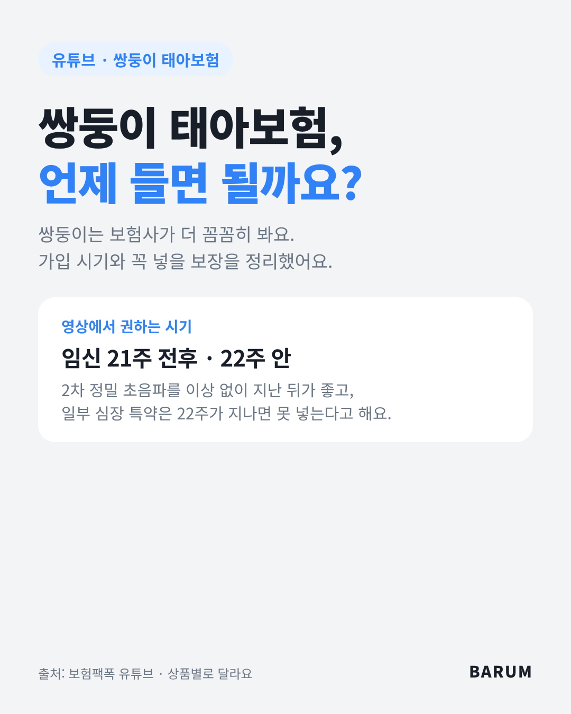
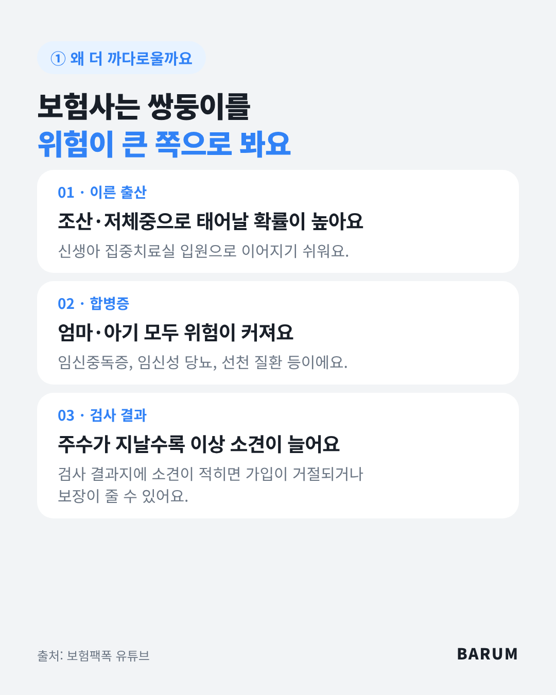
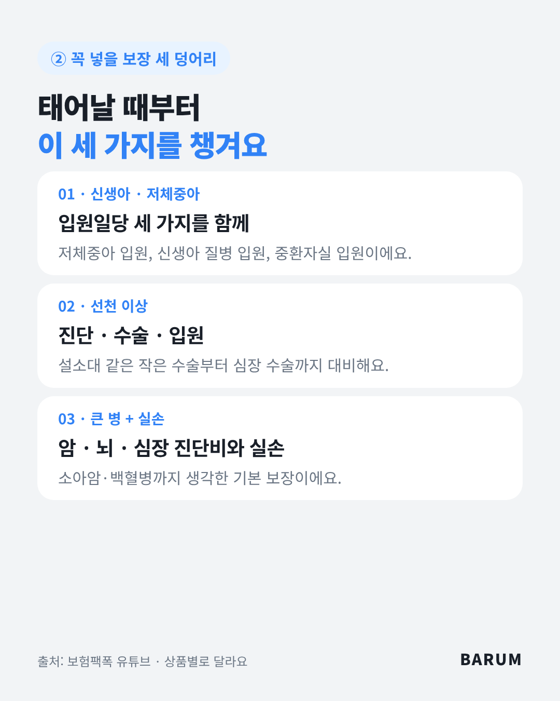
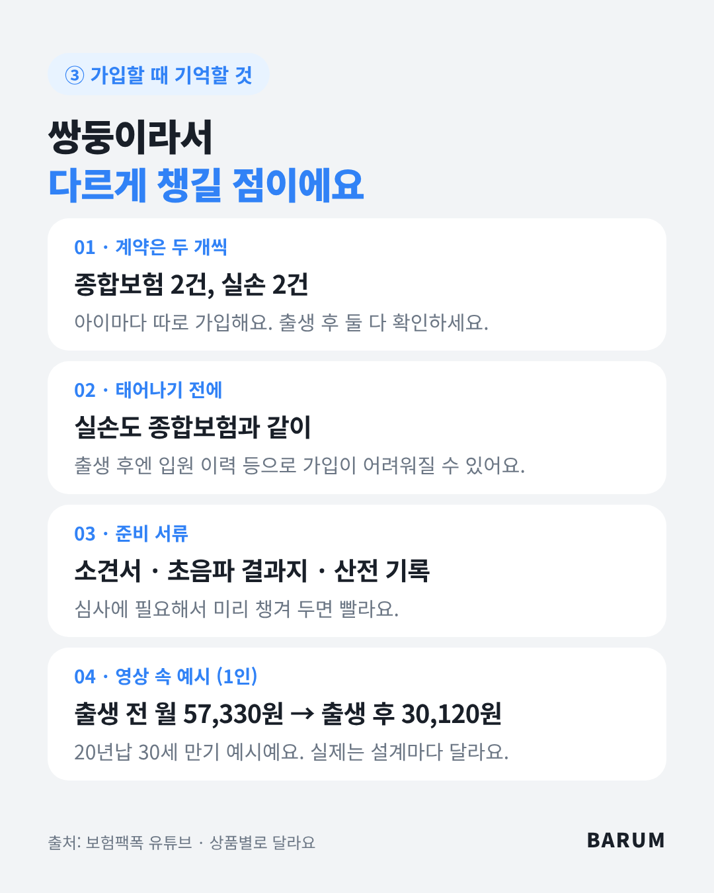
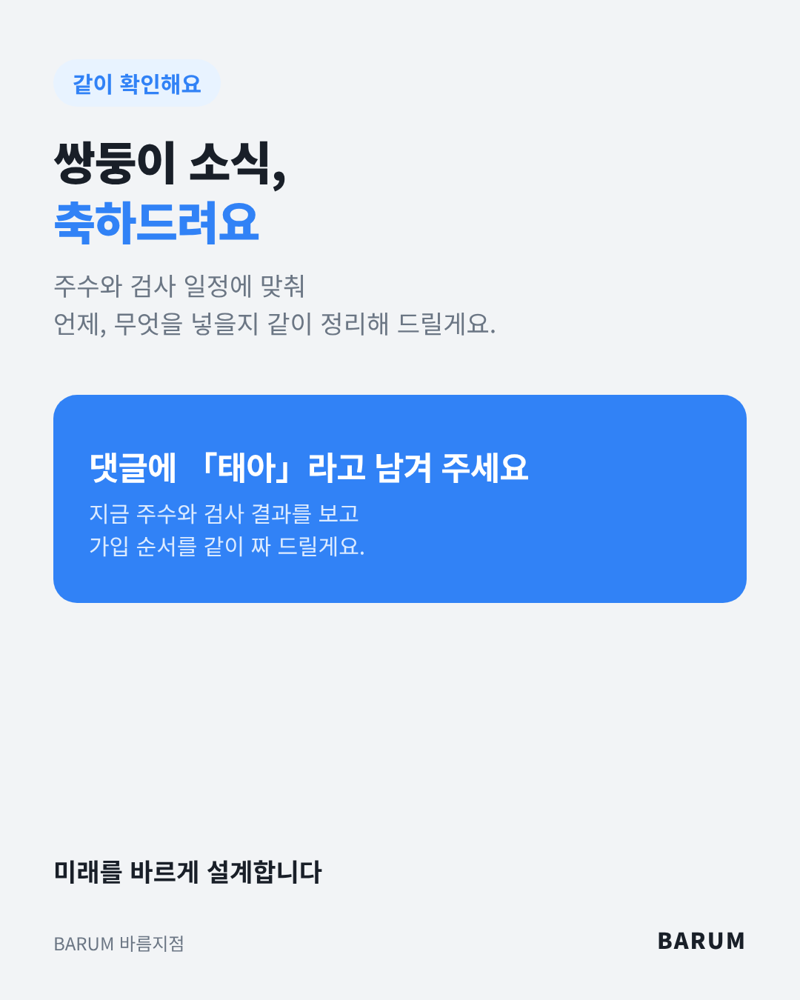

# 2026-11-26 오늘의 추천 영상

## 카드뉴스 (세로 1080×1350 · 고객 공유용)

카드 묶음 받기: https://raw.githubusercontent.com/bokkile83-ui/barum-news/main/yt/cards/2026-11-26_카드.zip

## 쌍둥이 태아보험 — 가입 시기와 꼭 넣을 보장

- [쌍둥이태아보험 추천 쌍둥이보험 비교해서 시험관 이란성 일란성 가입하기(순위 설계 상품)](https://www.youtube.com/watch?v=ExpDScAEs8Y)
- 한 줄: 쌍둥이 태아보험이 단태아보다 까다로운 이유, 가입 시기(21~22주), 꼭 넣을 보장 세 덩어리와 설계 예시를 설명하는 영상(18분 34초).
- 채널: 보험팩폭 · 올린 날짜 2026-11-23

## 핵심 정리
- 보험사는 쌍둥이를 「위험 두 배」로 봐요. 조산·저체중아 출생, 임신중독증·임신성 당뇨, 선천 질환 위험이 높고, 주수가 지날수록 검사에서 이상 소견이 나올 확률도 높다는 이유예요. 그래서 인수를 꺼리거나 담보를 줄이는 회사가 많아요. (01:11~02:46)
- 단태아는 임신 확인 뒤 바로 심사할 수 있지만, 쌍둥이는 16주 이후 심사가 되고 2차 정밀 초음파를 이상 없이 지난 21주 전후를 권해요. 어린이 개흉심장수술비·심장시술비는 22주가 지나면 못 넣는다고 해요. (03:06~03:34, 13:00)
- 심사에는 의사 소견서, 기형아·정밀 초음파 결과지, 산전 기록지가 필요해요. (03:34~03:47)
- 꼭 넣을 보장은 세 덩어리예요. ① 저체중아·신생아 질병·신생아 중환자실 입원일당 ② 선천이상 진단·수술·입원 ③ 암·뇌·심장 진단비와 실손. (03:48~05:35)
- 실손은 회사마다 보장이 같아요. 출생 후에는 입원 이력 등으로 가입이 어려워질 수 있어 태어나기 전에 종합보험과 같이 들라고 해요. (05:49~06:35)
- 쌍둥이는 아이마다 종합보험 1건·실손 1건씩, 모두 4건을 따로 가입해요. (07:25, 17:16)
- 영상 예시(21주 남아, 20년납 30세 만기): 종합보험 1인당 출생 전 월 57,330원, 출생 후 30,120원. (07:18, 17:10)
- 예시 특약: 저체중아입원일당 2.5kg 이하·3일째부터 하루 5만 원(60일 한도), 신생아질병입원일당 하루 1만 원(120일), 선천이상수술비 특정 300만 원·다발성 20만 원, 질병후유장해(선천 포함) 3천만 원, 중환자실 입원 시 중환자실 일당과 질병입원일당 중복 지급. (08:37~11:31)
- 신생아 뇌출혈처럼 뇌혈관질환만 있으면 적게 나올 수 있어 뇌졸중 진단비를 같이 넣는 이유도 설명해요. (10:20~10:41)

## 설계사에게
- 결론: 쌍둥이 태아보험은 「시기」가 절반이다. 2차 정밀 초음파 결과가 나온 직후, 22주 전에 청약이 끝나도록 일정을 역산한다.
- 고객에게 소견서·초음파 결과지·산전 기록지를 미리 받아 둔다. 검사지에 이상 소견이 있으면 인수 결과를 단정하지 않는다.
- 아이마다 계약이 따로라 보험료도 두 배다. 예산을 먼저 묻고 핵심 세 덩어리(신생아·저체중아 입원, 선천이상, 큰 병+실손)부터 채운다.
- 실손은 출생 전에 같이 넣도록 안내한다. 종합보험 회사와 맞추면 관리가 쉽다.
- 영상의 회사 순위·연락처·특정 상품 안내는 쓰지 않는다. 영상 화면의 조산·저체중아 비율 숫자는 표기가 엇갈려 옮기지 않았다.

## 오늘 고객에게 한마디
> 「쌍둥이는 보험사가 더 꼼꼼히 봐서 가입 시기가 중요해요. 정밀 초음파 일정에 맞춰 언제 무엇을 넣을지 같이 정리해 드릴게요.」

— BARUM 바름지점

> 내용은 회사·상품마다 다를 수 있으니 공식 자료와 같이 본다.
