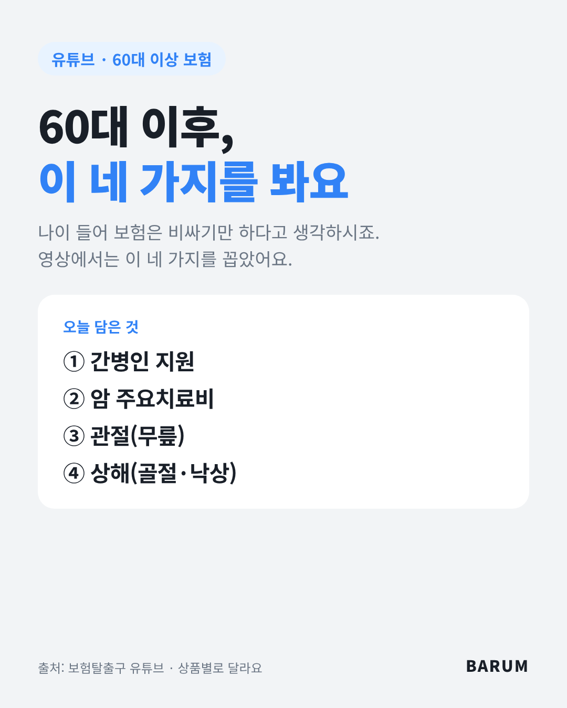
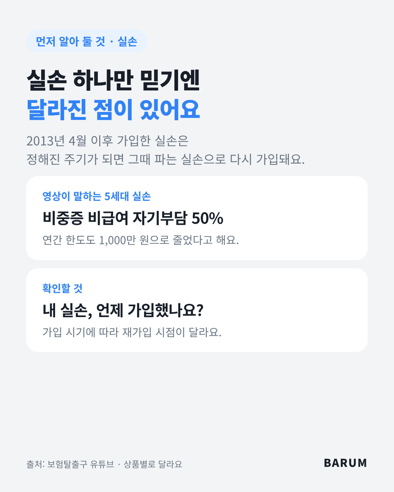
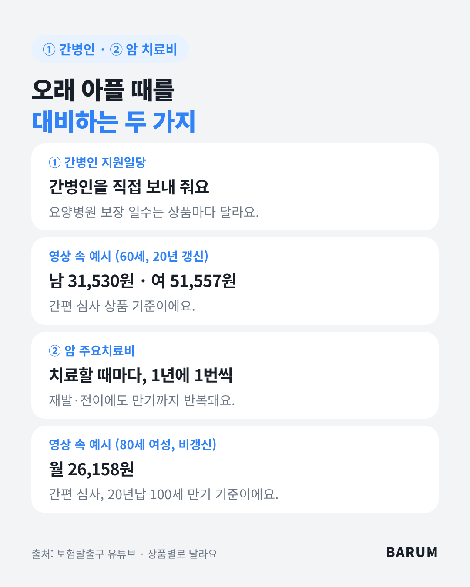
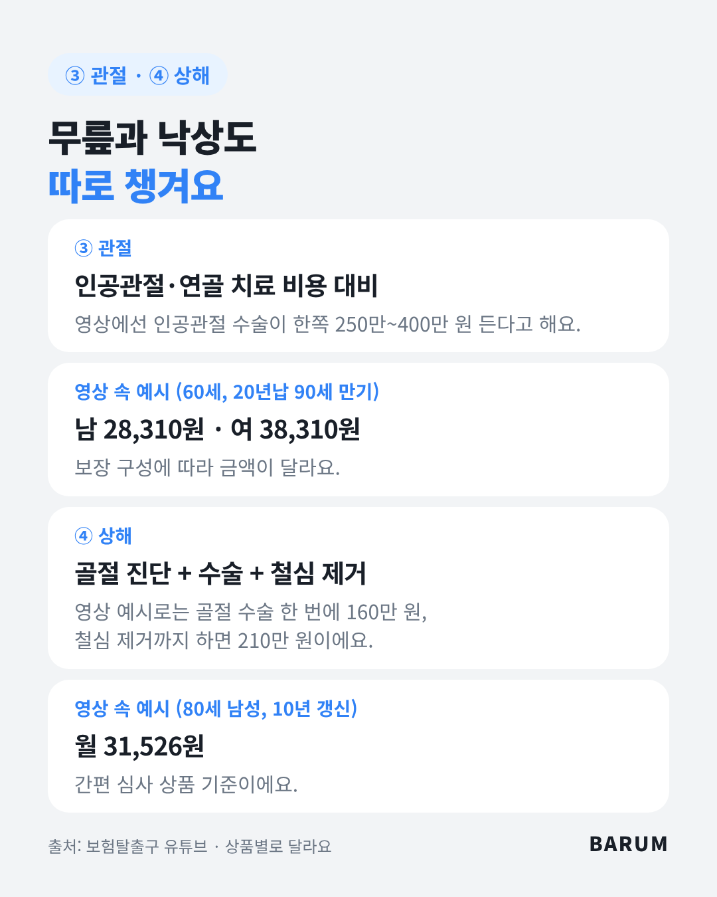
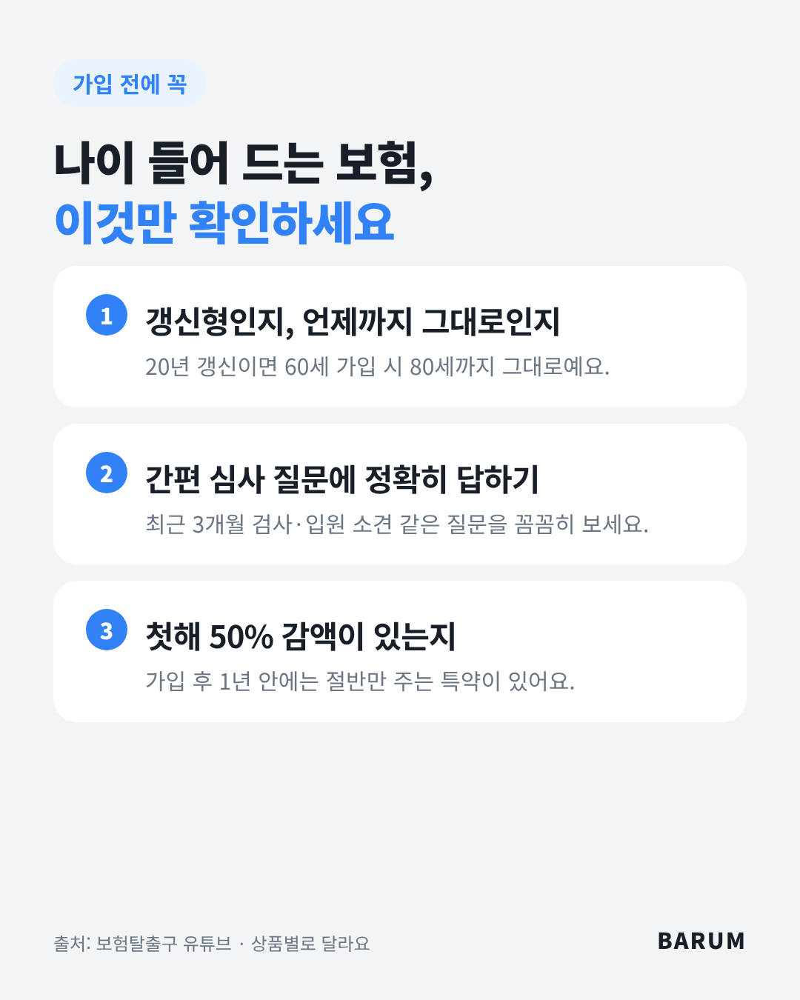
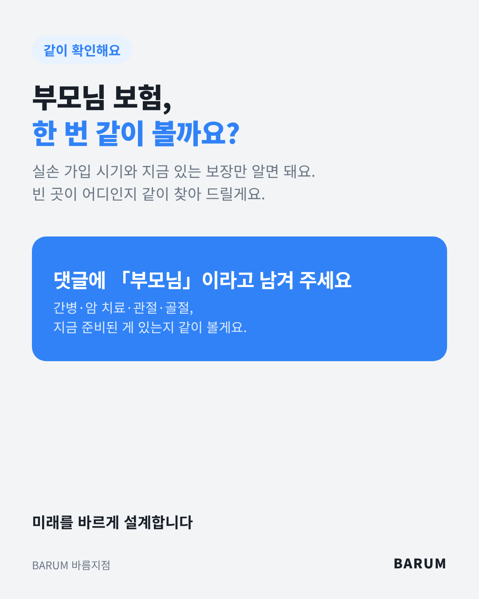

# 2026-11-27 오늘의 추천 영상

## 카드뉴스 (세로 1080×1350 · 고객 공유용)

카드 묶음 받기: https://raw.githubusercontent.com/bokkile83-ui/barum-news/main/yt/cards/2026-11-27_카드.zip

## 60대 이상 보험 — 간병·암 치료비·관절·상해

- [80세도 2만6천원에 가능한 암주요치료비? 60대 이상 강력 추천 4가지 보험.](https://www.youtube.com/watch?v=atDE0gjXt-k)
- 한 줄: 60대 이상에게 맞는 보험 4가지(간병인 지원, 암 주요치료비, 관절, 상해)와 실손 재가입 주기를 설명하는 영상(15분 14초).
- 채널: 보험탈출구 · 올린 날짜 2026-11-10

## 핵심 정리
- 2013년 4월 이후 가입한 실손은 재가입 주기가 오면 그때 파는 실손으로 다시 가입된다고 해요. 영상은 5세대 실손의 비중증 비급여 자기부담 50%, 연간 한도 1,000만 원을 들며 실손 하나에만 기대지 말라고 해요. (00:00, 10:54~12:06)
- ① 간병인 지원일당: 간병인을 직접 보내 주는 방식이에요. 간호·간병통합서비스 병동이면 정해진 입원일당을 줘요. 영상 상품은 20년 갱신(100세 갱신 종료), 요양병원 365일 지원이에요. 예시 60세 남 월 31,530원·여 51,557원. (01:13~04:01)
- ② 암 주요치료비: 수술·방사선·약물(호르몬 제외)·중환자실 각 1,000만 원, 연 1회씩 만기까지 반복이에요. 네 가지를 한 해에 다 받으면 최대 4,000만 원이에요. 예시 80세 여성 비갱신 월 26,158원. (04:02~07:46)
- ③ 관절: 인공관절 수술이 한쪽 250만~400만 원 든다고 해요. 예시 A플랜 60세 남 28,310원·여 38,310원, 고보장 B플랜(20년 갱신) 60세 여 24,474원·남 25,899원. (07:52~10:53)
- ④ 상해: 골절 진단 60만 + 재해수술 100만 + 철심 제거 50만 원 예시로 골절 한 번에 210만 원이에요. 재해통합진단은 경증 5만·중등증 50만·중증 500만 원(부위별 연 1회). 예시 80세 남성 월 31,526원. (12:20~14:03)
- 네 가지 모두 간편 심사(3·10·10 또는 3·5·5) 상품 예시예요. 고혈압·당뇨 같은 만성질환이 있어도 가입할 수 있는 구조예요. (01:50, 04:20, 07:34)

## 설계사에게
- 결론: 60대 이상 상담은 「실손 가입 시기(재가입 주기) 확인 → 간병·암 치료비·관절·골절 중 빈 곳」 순서로 본다.
- 갱신형은 「몇 년 동안 그대로인지, 갱신 종료 나이」를 꼭 말한다. 고령자는 갱신 보험료 인상이 해지 사유가 된다.
- 간편 심사는 3개월 이내 추가검사·입원 소견 질문을 고객과 같이 읽는다. 대신 판단하지 않는다.
- 영상은 관절 특약 약관에 「진단을 받고」 문구가 없어 가입 전 진단자도 보험기간 중 치료 시 받을 수 있다고 설명한다. 약관 해석은 회사마다 다르니 상담에 쓰기 전 해당 상품 약관과 언더라이팅에 반드시 확인한다.
- 1년 미만 50% 감액 특약이 섞여 있다. 고객에게 첫해 감액을 먼저 알린다.
- 영상의 회사명·연락처·보험료는 시점 예시다. 실제 설계는 우리 회사 최신 자료로 다시 뽑는다.

## 오늘 고객에게 한마디
> 「부모님 실손이 언제 가입한 건지부터 보면 돼요. 간병, 암 치료비, 무릎, 골절 중에 빈 곳이 있는지 같이 확인해 드릴게요.」

— BARUM 바름지점

> 내용은 회사·상품마다 다를 수 있으니 공식 자료와 같이 본다.
