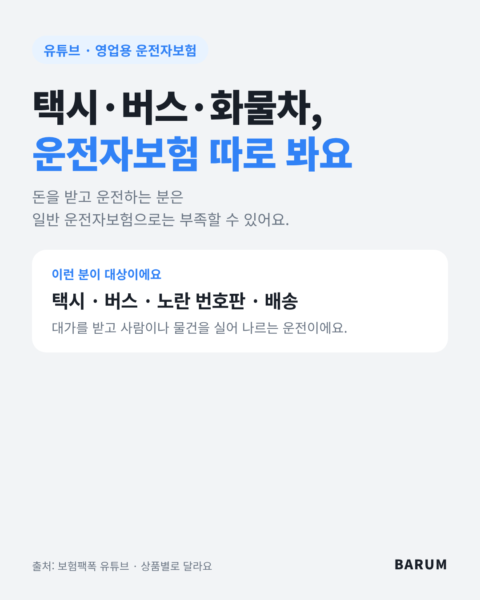
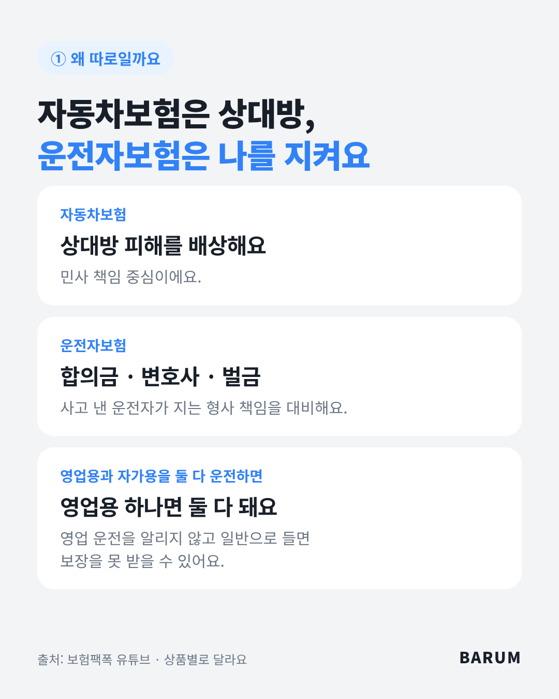
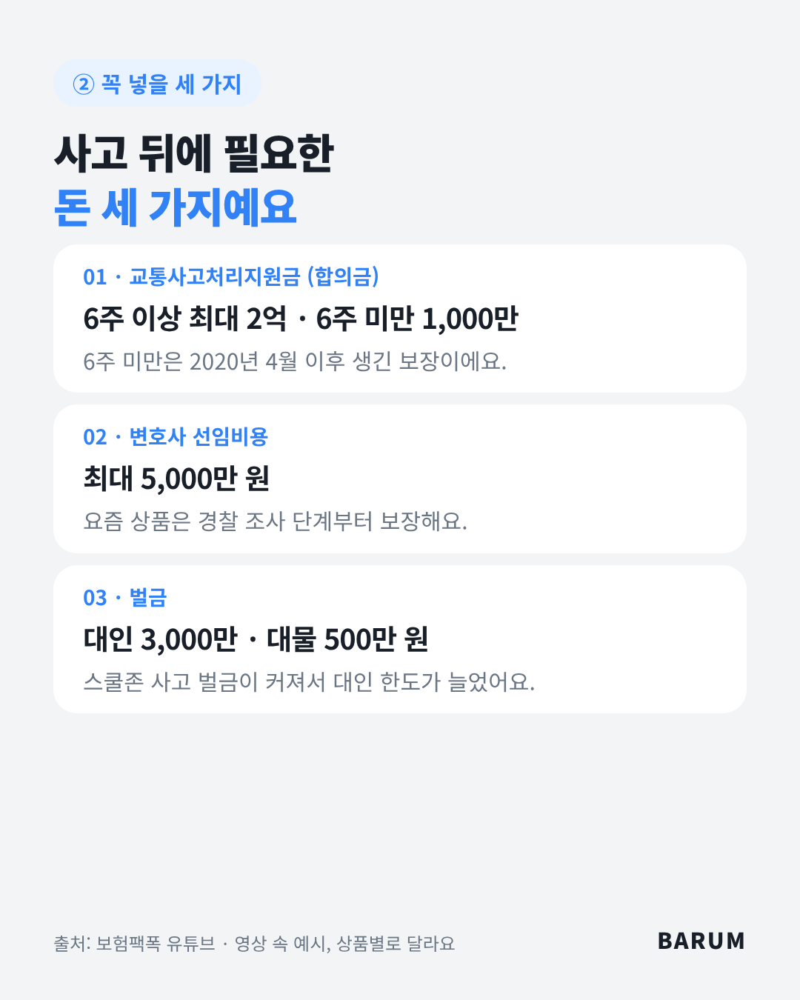
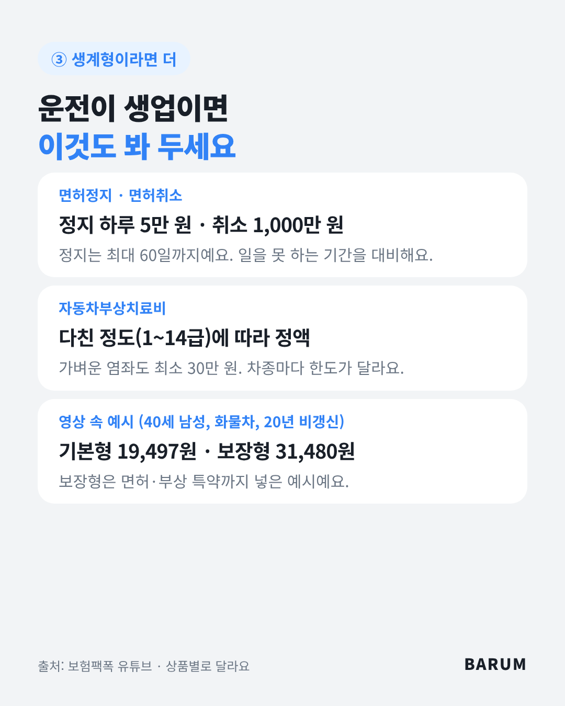
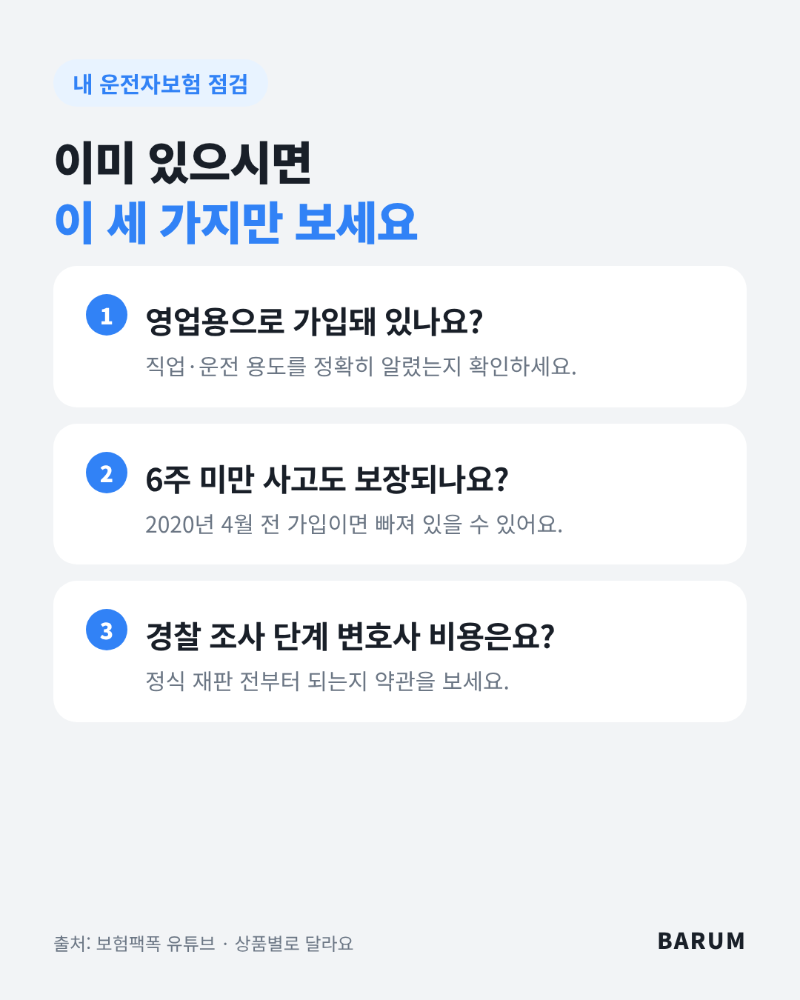
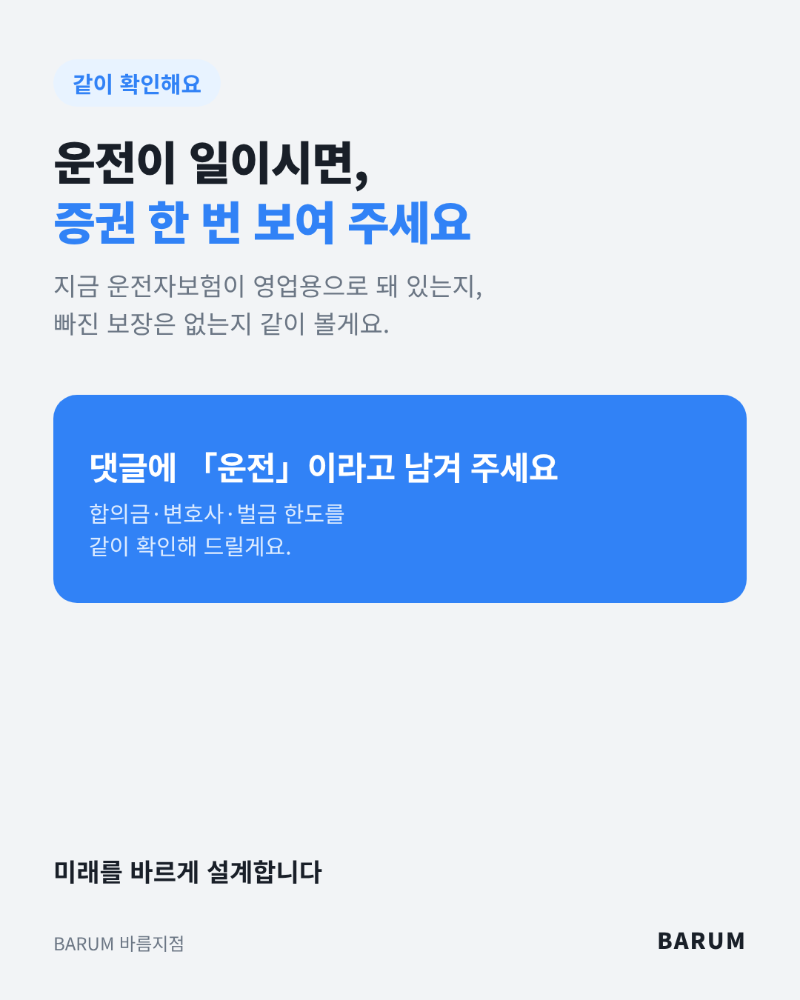

# 2026-11-28 오늘의 추천 영상

## 카드뉴스 (세로 1080×1350 · 고객 공유용)

카드 묶음 받기: https://raw.githubusercontent.com/bokkile83-ui/barum-news/main/yt/cards/2026-11-28_카드.zip

## 영업용 운전자보험 — 택시·버스·화물차 운전자

- [영업용운전자보험 추천 영업용차량운전자보험 비교해서 보험료 최저가로 가입하기(화물차 버스 택시)](https://www.youtube.com/watch?v=Fs1QfWVVcKE)
- 한 줄: 택시·버스·화물차처럼 돈을 받고 운전하는 사람이 왜 영업용 운전자보험을 따로 들어야 하는지, 꼭 넣을 보장과 점검할 점을 설명하는 영상(9분 21초).
- 채널: 보험팩폭 · 올린 날짜 2026-11-27

## 핵심 정리
- 택시·버스·노란 번호판 화물차, 대가를 받고 물건을 배달하는 운전자는 영업용 운전자보험으로 가입해야 사고 때 제대로 보장받는다고 해요. (00:17~00:33)
- 자가용과 영업용을 같이 운전하면 영업용 하나만 들면 둘 다 보장돼요. 중복 가입은 안 돼요. (00:34~01:00)
- 자동차보험은 상대방 배상(민사), 운전자보험은 합의금·변호사·벌금 같은 운전자 본인의 형사 책임을 대비해요. (01:10~01:58)
- 교통사고처리지원금: 상대방 사망·중상해·12대 중과실 사고 때 합의금. 6주 이상 최대 2억 원, 6주 미만 최대 1,000만 원(2020년 4월 이후 신설). 공탁금 선지급·비탑승 중 사고 보장도 확인하래요. (01:26~02:24, 06:31~07:11)
- 변호사 선임비용 최대 5,000만 원. 2023년 이후 상품은 경찰 조사 단계부터 보장해요. (02:25~03:15)
- 벌금: 대인 3,000만 원(스쿨존 사고 반영), 대물 500만 원. (03:16~03:49)
- 면허정지 하루 5만 원(최대 60일), 면허취소 1,000만 원. 운전이 생업이면 도움이 된다고 해요. (03:53~04:27)
- 자동차부상치료비는 부상 1~14급에 따라 정액이에요. 14급 염좌·타박상도 최소 30만 원. 영업용은 차종마다 한도가 달라요. (04:31~05:37)
- 예시(40세 남성, 화물차, 20년납 20년 만기 비갱신): 기본형 월 19,497원, 보장형(면허·부상 특약 포함) 월 31,480원. (07:00~08:30)

## 설계사에게
- 결론: 운전이 생업인 고객은 「영업용으로 가입돼 있는지」부터 확인한다. 영업 운전을 알리지 않은 일반 운전자보험은 사고 때 분쟁이 될 수 있다.
- 기존 가입자는 세 가지를 점검한다: 6주 미만 처리지원금(2020년 4월 전 가입이면 빠졌을 수 있음), 경찰 조사 단계 변호사 비용, 대인 벌금 3,000만 원 한도.
- 택시·버스·화물차는 차종마다 자동차부상치료비 한도가 다르다. 직업·차종을 정확히 받고 설계한다.
- 면허정지·취소 특약은 생계형 운전자에게만 권한다. 예산 안에서 핵심 세 가지를 먼저 채운다.
- 영상의 연락처·회사 비교 안내는 쓰지 않는다. 보험료는 우리 회사 설계로 다시 뽑는다.

## 오늘 고객에게 한마디
> 「운전이 일이시면 운전자보험이 영업용으로 돼 있는지부터 봐야 해요. 증권 한 장만 보여 주시면 합의금·변호사·벌금 한도까지 같이 확인해 드릴게요.」

— BARUM 바름지점

> 내용은 회사·상품마다 다를 수 있으니 공식 자료와 같이 본다.
